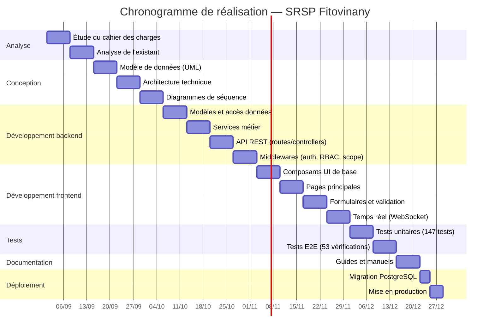

# CHAPITRE 3 : PRÉSENTATION DU PROJET

## 3.1 Formulation du projet

### 3.1.1 Contexte

Le **Service Régional de la Solde et des Pensions (SRSP) Fitovinany** est une structure déconcentrée du Ministère de l'Économie et des Finances, située à Manakara (Madagascar). Il est chargé de la gestion des dossiers administratifs des fonctionnaires et pensionnés de la région Fitovinany, couvrant notamment :

- **Les visas** : contrôle et visa des actes administratifs (mariage, naissance, décès, etc.)
- **Le solde** : mandatements, avances, oppositions, domiciliations
- **Les pensions** : liquidation, mandatement, émargement, oppositions
- **Les secours de décès** : visa du contrôle financier, mandatement, émargement, signature, cachet

Le traitement de ces dossiers implique plusieurs services (Secrétariat, divisions techniques, Chef de Division, Chef de Service, Coordination) et suit un circuit administratif strict défini par le cahier des charges v2.0.

### 3.1.2 Problématique

Avant ce projet, la gestion des dossiers se faisait de manière **manuelle et papier** :
- Les dossiers circulaient physiquement d'un service à l'autre
- Le suivi de l'avancement était difficile (pas de visibilité sur l'état d'un dossier)
- Les pièces justificatives n'étaient pas contrôlées de manière systématique
- Les transmissions entre services n'étaient pas tracées
- Les données d'opération (montants, références) étaient saisies sur papier
- Les rapports étaient produits manuellement
- Les dossiers bloqués n'étaient pas signalés

Cette situation entraînait des **pertes de temps**, des **erreurs**, des **dossiers perdus** et une **absence de traçabilité**.

### 3.1.3 Formulation

Le projet consiste à **développer une plateforme web de gestion, de suivi et de traçabilité des dossiers administratifs** pour le SRSP Fitovinany, permettant :

- La réception, l'enregistrement et l'orientation automatique des dossiers
- Le suivi du circuit de traitement par statut
- Le contrôle des pièces justificatives (dépouillement)
- La gestion des données d'opération par division
- La transmission entre services via bordereaux
- La signature et l'archivage
- La traçabilité complète (historique, notifications, signalements)
- La production de rapports et de statistiques
- Le cloisonnement par division et par périmètre

---

## 3.2 Justification de l'importance du sujet

### 3.2.1 Importance pour le service

Le SRSP Fitovinany traite des **dossiers sensibles** (visas, soldes, pensions, secours de décès) qui concernent des **fonctionnaires et des pensionnés**. La qualité et la rapidité du traitement ont un impact direct sur la vie des agents.

**Problèmes actuels résolus par le projet :**
- **Perte de dossiers** : traçabilité complète, historique durable
- **Dossiers bloqués silencieusement** : signalements, boîte de travail, alertes
- **Absence de visibilité** : tableau de bord, statistiques, rapports
- **Erreurs de saisie** : validation côté serveur, champs obligatoires
- **Délais de traitement** : suivi de l'ancienneté, dossiers en retard
- **Absence de cloisonnement** : RBAC, périmètre par division et par agent

### 3.2.2 Importance pour les utilisateurs

| Utilisateur | Bénéfice |
|---|---|
| **Secrétaire** | Réception et enregistrement rapides, orientation automatique, suivi des transmissions |
| **Agent de traitement** | File personnelle, tri par ancienneté, saisie des données d'opération, dépôt de pièces |
| **Chef de Division** | Vérification, validation, contrôle des pièces, signalement, rapports de division |
| **Chef de Service** | Signature, dérogation motivée, archivage, pilotage, performance |
| **Coordination** | Immatriculation, statistiques, rapports consolidés |
| **Administrateur** | Gestion des comptes, référentiel, configuration |

### 3.2.3 Importance pour l'administration

- **Conformité** : respect du cahier des charges v2.0 (460 exigences, 96% livrées)
- **Traçabilité** : journal d'audit complet, historique figé
- **Sécurité** : RBAC, cloisonnement, sessions révocables
- **Évolutivité** : référentiel configurable, schémas d'opération par type

---

## 3.3 Objectifs et besoins utilisateurs

### 3.3.1 Objectifs généraux

1. **Centraliser** la gestion des dossiers administratifs du SRSP Fitovinany
2. **Organiser** la distribution des dossiers entre les services et les agents
3. **Rendre visible** chaque étape du circuit de traitement
4. **Tracer** toutes les actions (historique, notifications, signalements)
5. **Cloisonner** les données par division et par périmètre
6. **Produire** des rapports et des statistiques

### 3.3.2 Objectifs spécifiques

| Objectif | Description |
|---|---|
| **Réception** | Enregistrement des dossiers avec matricule, identité, coordonnées du demandeur |
| **Orientation** | Routage automatique par type de dossier vers la division concernée |
| **Instruction** | Saisie des données d'opération, dépôt et contrôle des pièces |
| **Vérification** | Contrôle par le Chef de Division, validation ou correction |
| **Signature** | Signature par le Chef de Service (distincte de la vérification) |
| **Archivage** | Archivage conditionné à la signature et aux pièces d'archivage |
| **Transmission** | Bordereaux de transmission entre services, avec trace |
| **Signalement** | Remontée des dossiers bloqués sans changer le statut du dossier |
| **Rapports** | PDF et Excel exportables, cloisonnés par division |

### 3.3.3 Besoins utilisateurs

#### Secrétaire
- Créer et enregistrer des dossiers
- Orienter automatiquement par type
- Affecter à un agent
- Émettre des bordereaux de transmission
- Gérer les courriers
- Consulter la boîte de travail

#### Agent de traitement
- Consulter sa file personnelle
- Instruire le dossier (données d'opération, pièces)
- Dépouiller les pièces (Présente/Absente/Rejetée/Non applicable)
- Soumettre au Chef de Division
- Demander un complément

#### Chef de Division
- Vérifier les dossiers soumis
- Valider ou demander une correction (avec motif)
- Contrôler les pièces
- Contrôler les données d'opération
- Signaler un dossier bloqué
- Consulter les rapports de sa division

#### Chef de Service
- Signer les dossiers validés
- Archiver les dossiers signés
- Déroger à la validation (avec motif, tracé)
- Consulter les rapports consolidés
- Gérer les signalements

#### Coordination
- Immatriculer les agents
- Produire des statistiques
- Consulter les rapports

#### Administrateur
- Gérer les comptes et les rôles
- Configurer le référentiel (types, pièces, statuts, divisions)
- Gérer les schémas d'opération

---

## 3.4 Moyens nécessaires à la réalisation du projet

### 3.4.1 Moyens humains

| Rôle | Nombre | Responsabilité |
|---|---|---|
| Chef de projet / Développeur full-stack | 1 | Conception, développement, tests, déploiement |
| Responsable métier SRSP | 1 | Validation fonctionnelle, cahier des charges |
| Testeurs (agents SRSP) | 3-5 | Tests d'acceptation T18 |

### 3.4.2 Moyens matériels

| Élément | Spécification |
|---|---|
| Serveur d'application | PC ou serveur avec Node.js 22+, PostgreSQL 18 |
| Postes de travail | Navigateur web (Chrome, Firefox, Edge) |
| Réseau | Réseau local du SRSP Fitovinany |
| Stockage | Disque dur pour la base de données et les fichiers uploadés |

### 3.4.3 Moyens logiciels

| Logiciel | Version | Usage | Licence |
|---|---|---|---|
| Node.js | 22.22.2+ | Runtime backend + frontend | MIT |
| PostgreSQL | 18 | Base de données | PostgreSQL |
| React | 19.3 | Interface utilisateur | MIT |
| Vite | 8.3 | Bundler frontend | MIT |
| Express | 4.22 | Framework HTTP backend | MIT |
| Tailwind CSS | 4.3 | Styles utilitaires | MIT |
| Git | 2.x | Versionnement | GPL |
| GitHub | — | Dépôt distant | — |
| VS Code | — | Éditeur de code | MIT |
| PlantUML | — | Diagrammes UML | GPL |
| Mermaid | — | Diagrammes (GitHub) | MIT |

---

## 3.5 Chronogramme de réalisation du projet

### 3.5.1 Phases du projet

| Phase | Durée | Description |
|---|---|---|
| **Analyse** | 2 semaines | Étude du cahier des charges, analyse de l'existant |
| **Conception** | 3 semaines | UML, modèle de données, architecture |
| **Développement backend** | 4 semaines | API REST, modèles, services, middlewares |
| **Développement frontend** | 4 semaines | Interface React, composants, pages |
| **Tests** | 2 semaines | Tests unitaires, E2E, audit API |
| **Documentation** | 1 semaine | Guides, manuels, UML |
| **Déploiement** | 1 semaine | Installation, migration PostgreSQL, mise en production |

### 3.5.2 Diagramme de Gantt

### 3.5.3 Jalons

| Jalon | Date | Description |
|---|---|---|
| J1 | 15/09/2026 | Fin de l'analyse |
| J2 | 05/10/2026 | Fin de la conception |
| J3 | 02/11/2026 | Fin du développement backend |
| J4 | 30/11/2026 | Fin du développement frontend |
| J5 | 14/12/2026 | Fin des tests |
| J6 | 21/12/2026 | Fin de la documentation |
| J7 | 28/12/2026 | Mise en production |

---

## 3.6 Résultat attendu

### 3.6.1 Résultats techniques

- Une **plateforme web** accessible depuis tout navigateur
- Une **API REST** documentée et sécurisée
- Une **base de données PostgreSQL** avec 61 tables et 102 clés étrangères
- **147 tests unitaires** frontend passants
- **53 vérifications E2E** passantes
- **222 routes API** couvertes par l'audit frontend
- **8 diagrammes UML** (classes, architecture, séquences, états, déploiement)

### 3.6.2 Résultats fonctionnels

- **Gestion complète des dossiers** : création, enregistrement, orientation, affectation, instruction, vérification, validation, signature, archivage
- **Contrôle des pièces** : 6 états (Présente, Absente, Rejetée, Illisible, À corriger, Non applicable) avec motif obligatoire
- **Pièces jointes versionnées** : dépôt, téléchargement, suppression (avec traçabilité)
- **Données d'opération** : saisie par les agents, contrôle par les chefs, sans calcul automatique
- **Transmissions** : bordereaux entre divisions, avec trace
- **Signalements** : remontée des dossiers bloqués sans changer le statut
- **Rapports** : PDF et Excel exportables, cloisonnés par division
- **Statistiques** : tableau de bord, performance, évolution sur 12 mois
- **Temps réel** : WebSocket pour le rafraîchissement automatique

### 3.6.3 Résultats organisationnels

- **Traçabilité complète** : historique figé, journal d'audit, notifications
- **Cloisonnement** : par division et par périmètre, appliqué par le serveur
- **RBAC** : 13 postes avec permissions granulaires
- **Référentiel configurable** : types de dossiers, pièces, statuts, divisions, schémas d'opération
- **Documentation complète** : guides utilisateur, administrateur, formation, UML, conformité au cahier

---

*Fin du Chapitre 3 — Présentation du projet SRSP Fitovinany*