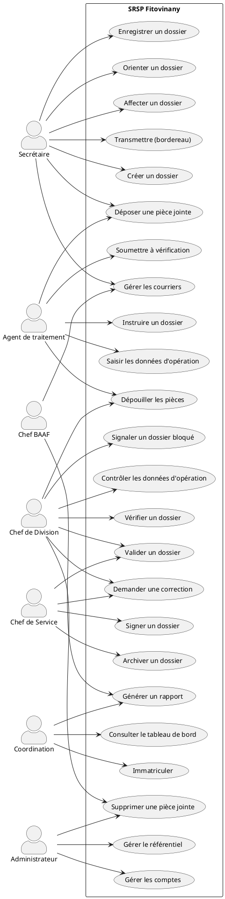
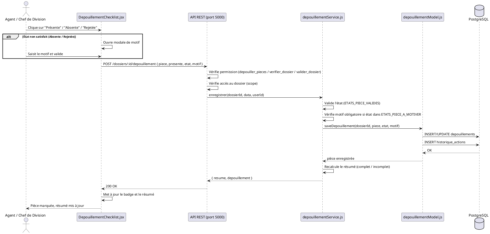
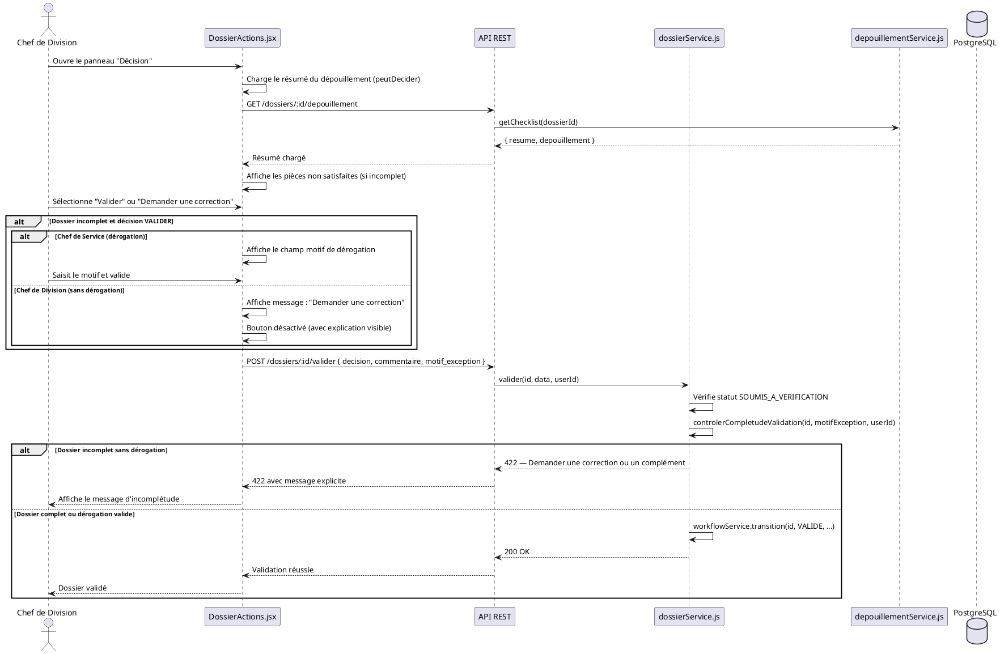
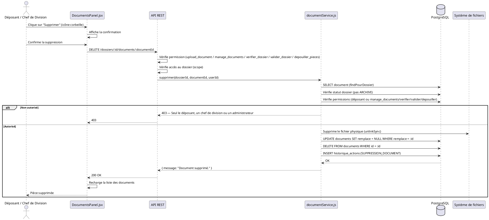

# CHAPITRE 5 : CONCEPTION DU PROJET

## 5.1 Présentation de la méthode de conception

### 5.1.1 Approche retenue

La conception du projet **SRSP Fitovinany** repose sur une approche **orientée objet**, conduite par le langage de modélisation unifié **UML 2.5**. La méthode retenue combine :

- **Analyse fonctionnelle** fondée sur le cahier des charges v2.0 du SRSP Fitovinany ;
- **Conception de base de données** relationnelle (PostgreSQL 18, collation ICU `ci`, timezone Africa/Nairobi) ;
- **Conception de l'architecture applicative** en couches (frontend React, backend Node.js/Express, base de données PostgreSQL) ;
- **Conception de l'interface utilisateur** selon les principes d'ergonomie et d'accessibilité.

La méthode de conception suit le cycle suivant :

1. **Identification des acteurs** et des cas d'utilisation (section 5.4) ;
2. **Modélisation du domaine** (section 5.7) ;
3. **Définition des règles de gestion** (section 5.3) ;
4. **Élaboration du dictionnaire des données** (section 5.2) ;
5. **Conception des diagrammes de séquence système** (section 5.6) ;
6. **Conception de l'architecture technique** (diagramme de déploiement, voir `docs/UML.md`).

### 5.1.2 Acteurs du système

Le système compte **13 postes** (rôles RBAC), répartis en trois catégories :

| Catégorie | Rôle | Permission principale |
|---|---|---|
| **Pilotage** | ADMIN | Administration technique (aucun pouvoir métier) |
| | CHEF_SERVICE | Signature, dérogation, archives, pilotage |
| | CHEF_BAAF | Secrétariat, courriers |
| | COORDINATRICE | Suivi, statistiques, rapports |
| **Division** | CHEF_DIVISION_VISA | Vérification, validation, visa |
| | CHEF_DIVISION_SOLDE | Vérification, validation, solde |
| | CHEF_DIVISION_PENSION | Vérification, validation, pension |
| | CHEF_DIVISION_SECOURS | Vérification, validation, secours |
| | VERIFICATEUR_VISA | Traitement, dépouillement, visa |
| | VERIFICATEUR_SOLDE | Traitement, dépouillement, solde |
| | LIQUIDATEUR_PENSION | Traitement, dépouillement, pension |
| | CHARGE_SECOURS | Traitement, dépouillement, secours |
| **Secrétariat** | SECRETAIRE | Réception, enregistrement, orientation, transmission |

### 5.1.3 Outils de conception

| Outil | Usage |
|---|---|
| UML 2.5 | Modélisation (cas d'utilisation, séquence, états, classes, déploiement) |
| PlantUML / Mermaid | Génération des diagrammes |
| PostgreSQL 18 | Modélisation relationnelle, contraintes, index |
| React 18 + Vite | Conception de l'interface utilisateur |
| Node.js / Express | Conception de l'API REST |

---

## 5.2 Dictionnaire des données

### 5.2.1 Entités principales

Le schéma compte **61 tables**. Voici les entités principales avec leurs attributs clés :

#### `dossiers` — Dossier administratif

| Attribut | Type | Null | Description |
|---|---|---|---|
| `id` | entier | non | Identifiant unique |
| `numero` | texte | non | Numéro de dossier (`{TYPE}-{ANNEE}-{6 chiffres}`) |
| `reference_visa` | texte | oui | Référence VISA unique |
| `type_id` | entier (FK) | non | Type de dossier (VISA, SOLDE, PENSION, SECOURS) |
| `sous_type_id` | entier (FK) | oui | Type d'acte / type d'opération |
| `objet` | texte | oui | Objet du dossier |
| `demandeur` | texte | oui | Nom du demandeur |
| `matricule` | texte | oui | Matricule de l'agent |
| `date_reception` | date | oui | Date de réception |
| `date_heure_reception` | horodatage | oui | Date et heure de réception (VISA) |
| `date_limite` | date | oui | Date limite de traitement |
| `division_id` | entier (FK) | non | Division destinataire (routage automatique) |
| `priorite_id` | entier (FK) | non | Priorité (URGENTE=4, HAUTE=3, NORMALE=2, BASSE=1) |
| `statut_id` | entier (FK) | non | Statut dans le circuit |
| `agent_responsable_id` | entier (FK) | oui | Agent responsable |
| `observation` | texte | oui | Observation |
| `date_cloture` | date | oui | Date de clôture |
| `date_archivage` | date | oui | Date d'archivage |
| `created_by` | entier (FK) | non | Créateur (user) |
| `demandeur_nom` | texte | oui | Nom du demandeur |
| `demandeur_prenom` | texte | oui | Prénom du demandeur |
| `demandeur_tel` | texte | oui | Téléphone du demandeur |
| `demandeur_email` | texte | oui | Email du demandeur |
| `demandeur_adresse` | texte | oui | Adresse du demandeur |
| `origine_presentateur` | texte | oui | Origine / présentateur (VISA) |
| `comptable_presentateur` | texte | oui | Comptable présentateur (VISA) |
| `type_acte` | texte | oui | Type d'acte (VISA) |
| `annee_reference` | entier | oui | Année de référence (VISA) |
| `verificateur_id` | entier (FK) | oui | Vérificateur VISA |
| `date_signature` | date | oui | Date de signature |
| `signataire_id` | entier (FK) | oui | Signataire (Chef de Service) |
| `reference_signature` | texte | oui | Référence de signature |
| `exception_validation` | texte | oui | Motif de dérogation |
| `exception_autorisee_par` | entier (FK) | oui | Auteur de la dérogation |
| `date_exception` | date | oui | Date de la dérogation |
| `motif_complement` | texte | oui | Motif de complément |
| `beneficiaire` | texte | oui | Bénéficiaire (Secours) |
| `organisme` | texte | oui | Organisme (Secours) |

#### `users` — Compte utilisateur

| Attribut | Type | Null | Description |
|---|---|---|---|
| `id` | entier | non | Identifiant unique |
| `username` | texte | non | Identifiant de connexion |
| `email` | texte | non | Email |
| `password_hash` | texte | non | Hash du mot de passe (bcrypt) |
| `role_id` | entier (FK) | non | Rôle (RBAC) |
| `actif` | entier | non | Compte actif (1/0) |
| `derniere_connexion` | horodatage | oui | Dernière connexion |
| `mot_de_passe_change_le` | horodatage | oui | Date de changement de mot de passe |
| `tentatives_echouees` | entier | oui | Tentatives échouées |
| `verrouille_jusqua` | horodatage | oui | Verrouillage jusqu'à |

#### `agents` — Fiche agent

| Attribut | Type | Null | Description |
|---|---|---|---|
| `id` | entier | non | Identifiant unique |
| `user_id` | entier (FK) | oui | Compte utilisateur associé |
| `nom` | texte | non | Nom |
| `prenom` | texte | oui | Prénom |
| `matricule` | texte | oui | Matricule |
| `fonction_id` | entier (FK) | oui | Fonction |
| `division_id` | entier (FK) | oui | Division |
| `email` | texte | oui | Email |
| `telephone` | texte | oui | Téléphone |
| `actif` | entier | non | Actif (1/0) |

#### `divisions` — Division

| Attribut | Type | Null | Description |
|---|---|---|---|
| `id` | entier | non | Identifiant unique |
| `code` | texte | non | Code (VISA, SOLDE, PENSION, SECOURS) |
| `nom` | texte | non | Nom de la division |
| `type_dossier_id` | entier (FK) | oui | Type de dossier associé |
| `responsable_id` | entier (FK) | oui | Agent responsable |

#### `types_dossiers` — Type de dossier

| Attribut | Type | Null | Description |
|---|---|---|---|
| `id` | entier | non | Identifiant unique |
| `code` | texte | non | Code (VISA, SOLDE, PENSION, SECOURS) |
| `libelle` | texte | non | Libellé |
| `actif` | entier | non | Actif (1/0) |

#### `sous_types_dossiers` — Sous-type de dossier (type d'acte / type d'opération)

| Attribut | Type | Null | Description |
|---|---|---|---|
| `id` | entier | non | Identifiant unique |
| `type_dossier_id` | entier (FK) | non | Type de dossier parent |
| `code` | texte | non | Code |
| `libelle` | texte | non | Libellé |
| `actif` | entier | non | Actif (1/0) |
| `ordre` | entier | non | Ordre d'affichage |

#### `statuts_dossiers` — Statut du circuit

| Attribut | Type | Null | Description |
|---|---|---|---|
| `id` | entier | non | Identifiant unique |
| `code` | texte | non | Code (RECU, ENREGISTRE, ORIENTE, AFFECTE, EN_TRAITEMENT, EN_ATTENTE_COMPLEMENT, SOUMIS_A_VERIFICATION, CORRECTION_DEMANDEE, VALIDE, SIGNE, CLOTURE, ARCHIVE, BROUILLON) |
| `libelle` | texte | non | Libellé |
| `ordre` | entier | non | Ordre dans le circuit |

#### `priorites` — Priorité

| Attribut | Type | Null | Description |
|---|---|---|---|
| `id` | entier | non | Identifiant unique |
| `code` | texte | non | Code (URGENTE, HAUTE, NORMALE, BASSE) |
| `libelle` | texte | non | Libellé |
| `niveau` | entier | non | Niveau (URGENTE=4, HAUTE=3, NORMALE=2, BASSE=1) |

#### `types_pieces` — Type de pièce (checklist)

| Attribut | Type | Null | Description |
|---|---|---|---|
| `id` | entier | non | Identifiant unique |
| `code` | texte | non | Code de la pièce |
| `libelle` | texte | non | Libellé |
| `type_dossier_id` | entier (FK) | oui | Type de dossier (NULL = toutes) |
| `sous_type_id` | entier (FK) | oui | Sous-type (NULL = tous) |
| `phase` | texte | non | Phase (DEPOUILLEMENT / ARCHIVAGE) |
| `obligatoire` | entier | non | Obligatoire (1/0) |
| `actif` | entier | non | Actif (1/0) |
| `ordre` | entier | non | Ordre d'affichage |

#### `depouillements` — Dépouillement d'une pièce

| Attribut | Type | Null | Description |
|---|---|---|---|
| `id` | entier | non | Identifiant unique |
| `dossier_id` | entier (FK) | non | Dossier |
| `agent_id` | entier (FK) | oui | Agent contrôleur |
| `piece` | texte | non | Code de la pièce |
| `presente` | entier | non | Présente (1/0) |
| `etat` | texte | non | État (PRESENTE, MANQUANTE, REJETEE, ILLISIBLE, A_CORRIGER, NON_APPLICABLE) |
| `observation` | texte | oui | Observation |
| `motif` | texte | oui | Motif (obligatoire pour MANQUANTE, REJETEE, ILLISIBLE, A_CORRIGER) |
| `date_controle` | horodatage | non | Date de contrôle |

#### `documents` — Pièce jointe (versionnée)

| Attribut | Type | Null | Description |
|---|---|---|---|
| `id` | entier | non | Identifiant unique |
| `dossier_id` | entier (FK) | oui | Dossier |
| `courrier_id` | entier (FK) | oui | Courrier |
| `type_id` | entier (FK) | oui | Type de document |
| `piece_code` | texte | oui | Code de la pièce |
| `version` | entier | non | Numéro de version |
| `remplace` | entier | oui | ID de la version remplacée |
| `motif_remplacement` | texte | oui | Motif du remplacement |
| `nom_fichier` | texte | non | Nom d'origine du fichier |
| `chemin_stockage` | texte | non | Chemin opaque (UUID) |
| `taille` | entier | oui | Taille en octets |
| `description` | texte | oui | Description |
| `valide` | entier | oui | Valide (1/0) |
| `upload_par` | entier (FK) | oui | Déposé par (user) |
| `created_at` | horodatage | oui | Date de dépôt |

#### `historique_actions` — Journal d'audit

| Attribut | Type | Null | Description |
|---|---|---|---|
| `id` | entier | non | Identifiant unique |
| `dossier_id` | entier (FK) | oui | Dossier |
| `user_id` | entier (FK) | oui | Utilisateur |
| `action` | texte | non | Action (CREATION_DOSSIER, CHANGEMENT_STATUT, etc.) |
| `ancienne_valeur` | texte | oui | Ancienne valeur |
| `nouvelle_valeur` | texte | oui | Nouvelle valeur |
| `details` | texte | oui | Détails |
| `ip_address` | texte | oui | Adresse IP |
| `date_action` | horodatage | non | Date de l'action |

#### `notifications` — Notification

| Attribut | Type | Null | Description |
|---|---|---|---|
| `id` | entier | non | Identifiant unique |
| `user_id` | entier (FK) | non | Destinataire |
| `dossier_id` | entier (FK) | oui | Dossier concerné |
| `type` | texte | non | Type (INFO, ALERTE, etc.) |
| `action` | texte | non | Action déclenchante |
| `message` | texte | non | Message |
| `lu` | entier | non | Lu (1/0) |
| `created_at` | horodatage | oui | Date de création |

#### `bordereaux` — Bordereau de transmission

| Attribut | Type | Null | Description |
|---|---|---|---|
| `id` | entier | non | Identifiant unique |
| `reference` | texte | non | Référence auto-générée |
| `division_id` | entier (FK) | non | Division destinataire |
| `agent_id` | entier (FK) | non | Agent émetteur |
| `recu_par` | entier (FK) | oui | Agent récepteur |
| `statut` | texte | non | Statut (EMIS, RECU_PAR_DIVISION, ARCHIVE) |
| `date_transmission` | horodatage | non | Date de transmission |
| `observation` | texte | oui | Observation |

#### `courriers` — Courrier

| Attribut | Type | Null | Description |
|---|---|---|---|
| `id` | entier | non | Identifiant unique |
| `numero` | texte | non | Numéro |
| `sens` | texte | non | Sens (ENTRANT, SORTANT) |
| `type_id` | entier (FK) | non | Type de courrier |
| `division_id` | entier (FK) | oui | Division |
| `dossier_id` | entier (FK) | oui | Dossier lié |
| `document_id` | entier (FK) | oui | Document lié |
| `expediteur` | texte | oui | Expéditeur |
| `destinataire` | texte | oui | Destinataire |
| `objet` | texte | oui | Objet |
| `created_by` | entier (FK) | non | Créé par |
| `created_at` | horodatage | oui | Date de création |

#### `archives` — Archive

| Attribut | Type | Null | Description |
|---|---|---|---|
| `id` | entier | non | Identifiant unique |
| `dossier_id` | entier (FK) | non | Dossier |
| `date_archivage` | horodatage | non | Date d'archivage |
| `reference_archivage` | texte | oui | Référence d'archivage |
| `emplacement_physique` | texte | oui | Emplacement physique |
| `localisation_numerique` | texte | oui | Localisation numérique |
| `archive_par` | entier (FK) | non | Archivé par |
| `restaure` | entier | non | Restauré (1/0) |

#### `donnees_operation` — Données d'opération (Solde, Pensions, Secours)

| Attribut | Type | Null | Description |
|---|---|---|---|
| `id` | entier | non | Identifiant unique |
| `dossier_id` | entier (FK) | non | Dossier |
| `sous_type_id` | entier (FK) | oui | Type d'opération |
| `reference_externe` | texte | oui | Référence externe |
| `reference_dossier_mere` | texte | oui | Référence du dossier mère |
| `periode` | texte | oui | Période concernée |
| `montant` | décimal | oui | Montant saisi |
| `source_montant` | texte | oui | Source du montant |
| `valide_par` | entier (FK) | oui | Validé par |
| `date_validation` | horodatage | oui | Date de validation |
| `decision_controle` | texte | oui | Décision de contrôle (APPROUVE / RETOURNE) |
| `date_controle` | horodatage | oui | Date de contrôle |
| `controleur_id` | entier (FK) | oui | Contrôleur |
| `destinataire` | texte | oui | Destinataire |
| `localisation` | texte | oui | Localisation |
| `observation` | texte | oui | Observation |

#### `signalements_dossier` — Signalement de dossier bloqué

| Attribut | Type | Null | Description |
|---|---|---|---|
| `id` | entier | non | Identifiant unique |
| `dossier_id` | entier (FK) | non | Dossier |
| `division_id` | entier (FK) | oui | Division |
| `signale_par` | entier (FK) | non | Signalé par |
| `traite_par` | entier (FK) | oui | Traité par |
| `type` | texte | non | Type (BLOCAGE, INTERLOCUTION, ARBITRAGE) |
| `priorite` | texte | non | Priorité (HAUTE, CRITIQUE) |
| `motif` | texte | non | Motif (10 caractères minimum) |
| `statut` | texte | non | Statut (OUVERT, EN_COURS, RESOLU, REJETE) |
| `date_signalement` | horodatage | non | Date du signalement |
| `date_traitement` | horodatage | oui | Date de traitement |
| `resolution` | texte | oui | Résolution |

#### `mandatements` — Mandatement (Solde)

| Attribut | Type | Null | Description |
|---|---|---|---|
| `id` | entier | non | Identifiant unique |
| `dossier_id` | entier (FK) | non | Dossier |
| `numero` | texte | non | Numéro de mandatement |
| `montant_total` | décimal | oui | Montant total |
| `etat` | texte | oui | État du mandatement |
| `date_mandatement` | horodatage | oui | Date de mandatement |

#### `mandatement_beneficiaires` — Bénéficiaire d'un mandatement

| Attribut | Type | Null | Description |
|---|---|---|---|
| `id` | entier | non | Identifiant unique |
| `mandatement_id` | entier (FK) | non | Mandatement |
| `nom` | texte | non | Nom |
| `prenom` | texte | oui | Prénom |
| `montant` | décimal | oui | Montant |

#### `schemas_operations` — Schéma d'opération

| Attribut | Type | Null | Description |
|---|---|---|---|
| `id` | entier | non | Identifiant unique |
| `sous_type_id` | entier (FK) | non | Sous-type de dossier |
| `code` | texte | non | Code |
| `libelle` | texte | non | Libellé |

#### `messages` — Message interne

| Attribut | Type | Null | Description |
|---|---|---|---|
| `id` | entier | non | Identifiant unique |
| `expediteur_id` | entier (FK) | non | Expéditeur |
| `destinataire_id` | entier (FK) | non | Destinataire |
| `contenu` | texte | non | Contenu |
| `date_envoi` | horodatage | non | Date d'envoi |
| `lu` | entier | non | Lu (1/0) |

#### `reinitialisations_mot_de_passe` — Réinitialisation de mot de passe

| Attribut | Type | Null | Description |
|---|---|---|---|
| `id` | entier | non | Identifiant unique |
| `user_id` | entier (FK) | non | Utilisateur |
| `code` | texte | non | Code à usage unique (15 min) |
| `date_demande` | horodatage | non | Date de demande |
| `date_expiration` | horodatage | non | Date d'expiration |
| `utilise` | entier | non | Utilisé (1/0) |

#### `immatriculations` — Immatriculation (Coordination)

| Attribut | Type | Null | Description |
|---|---|---|---|
| `id` | entier | non | Identifiant unique |
| `dossier_id` | entier (FK) | non | Dossier |
| `type_demande` | texte | non | Type de demande |
| `reference` | texte | non | Référence attribuée |
| `division_id` | entier (FK) | non | Division |
| `created_at` | horodatage | oui | Date de création |

#### `suppressions_dossiers` — Trace de suppression

| Attribut | Type | Null | Description |
|---|---|---|---|
| `id` | entier | non | Identifiant unique |
| `dossier_id` | entier | oui | Dossier (peut être supprimé) |
| `numero` | texte | non | Numéro du dossier supprimé |
| `motif` | texte | non | Motif de suppression |
| `supprime_par` | entier (FK) | oui | Supprimé par |
| `supprime_par_nom` | texte | oui | Nom du supprimeur |
| `date_suppression` | horodatage | non | Date de suppression |
| `historique_json` | texte | oui | Instantané du journal |
| `nb_actions_historique` | entier | non | Nombre d'actions |

#### `archives` — Archive

| Attribut | Type | Null | Description |
|---|---|---|---|
| `id` | entier | non | Identifiant unique |
| `dossier_id` | entier (FK) | non | Dossier |
| `date_archivage` | horodatage | non | Date d'archivage |
| `reference_archivage` | texte | oui | Référence d'archivage |
| `emplacement_physique` | texte | oui | Emplacement physique |
| `localisation_numerique` | texte | oui | Localisation numérique |
| `archive_par` | entier (FK) | non | Archivé par |
| `restaure` | entier | non | Restauré (1/0) |

#### `bordereaux` — Bordereau de transmission

| Attribut | Type | Null | Description |
|---|---|---|---|
| `id` | entier | non | Identifiant unique |
| `reference` | texte | non | Référence auto-générée |
| `division_id` | entier (FK) | non | Division destinataire |
| `agent_id` | entier (FK) | non | Agent émetteur |
| `recu_par` | entier (FK) | oui | Agent récepteur |
| `statut` | texte | non | Statut (EMIS, RECU_PAR_DIVISION, ARCHIVE) |
| `date_transmission` | horodatage | non | Date de transmission |
| `observation` | texte | oui | Observation |

#### `bordereaux_dossiers` — Ligne de bordereau

| Attribut | Type | Null | Description |
|---|---|---|---|
| `bordereau_id` | entier (FK) | non | Bordereau |
| `dossier_id` | entier (FK) | non | Dossier |

#### `correspondances` — Correspondance

| Attribut | Type | Null | Description |
|---|---|---|---|
| `id` | entier | non | Identifiant unique |
| `dossier_id` | entier (FK) | non | Dossier |
| `type` | texte | non | Type (PRESCRIPTION, DEMANDE_DOSSIER_MERE, OPPOSITION, DERNIERS_ARRERAGES) |
| `reference` | texte | oui | Référence |
| `piece_code` | texte | oui | Code de la pièce liée |
| `etat_reponse` | texte | oui | État de réponse |
| `date_envoi` | date | oui | Date d'envoi |
| `date_reponse` | date | oui | Date de réponse |
| `created_by` | entier (FK) | non | Créé par |

#### `antennes` — Antenne territoriale

| Attribut | Type | Null | Description |
|---|---|---|---|
| `id` | entier | non | Identifiant unique |
| `code` | texte | non | Code |
| `libelle` | texte | non | Libellé |

#### `districts` — District

| Attribut | Type | Null | Description |
|---|---|---|---|
| `id` | entier | non | Identifiant unique |
| `code` | texte | non | Code |
| `libelle` | texte | non | Libellé |
| `antenne_id` | entier (FK) | non | Antenne |

#### `dossiers_districts` — Rattachement dossier-district

| Attribut | Type | Null | Description |
|---|---|---|---|
| `id` | entier | non | Identifiant unique |
| `dossier_id` | entier (FK) | non | Dossier |
| `district_id` | entier (FK) | non | District |

#### `decomptes_avance` — Décompte d'avance (Solde)

| Attribut | Type | Null | Description |
|---|---|---|---|
| `id` | entier | non | Identifiant unique |
| `dossier_id` | entier (FK) | non | Dossier |
| `agent_id` | entier (FK) | oui | Agent |
| `montant` | décimal | oui | Montant |
| `date_decompte` | date | oui | Date du décompte |

#### `controles_decompte` — Contrôle de décompte (Solde)

| Attribut | Type | Null | Description |
|---|---|---|---|
| `id` | entier | non | Identifiant unique |
| `dossier_id` | entier (FK) | non | Dossier |
| `controleur_id` | entier (FK) | oui | Contrôleur |
| `decision` | texte | oui | Décision |
| `date_controle` | horodatage | oui | Date de contrôle |

#### `liquidations_pension` — Liquidation de pension

| Attribut | Type | Null | Description |
|---|---|---|---|
| `id` | entier | non | Identifiant unique |
| `dossier_id` | entier (FK) | non | Dossier |
| `montant` | décimal | oui | Montant |
| `date_liquidation` | date | oui | Date de liquidation |

#### `mandatements` — Mandatement

| Attribut | Type | Null | Description |
|---|---|---|---|
| `id` | entier | non | Identifiant unique |
| `dossier_id` | entier (FK) | non | Dossier |
| `numero` | texte | non | Numéro |
| `montant_total` | décimal | oui | Montant total |
| `etat` | texte | oui | État |
| `date_mandatement` | horodatage | oui | Date de mandatement |

#### `mandatement_beneficiaires` — Bénéficiaire d'un mandatement

| Attribut | Type | Null | Description |
|---|---|---|---|
| `id` | entier | non | Identifiant unique |
| `mandatement_id` | entier (FK) | non | Mandatement |
| `nom` | texte | non | Nom |
| `prenom` | texte | oui | Prénom |
| `montant` | décimal | oui | Montant |

#### `mandatement_pieces` — Pièce d'un mandatement

| Attribut | Type | Null | Description |
|---|---|---|---|
| `id` | entier | non | Identifiant unique |
| `mandatement_id` | entier (FK) | non | Mandatement |
| `code` | texte | non | Code |
| `libelle` | texte | non | Libellé |

#### `mandatement_pieces_etat` — État d'une pièce de mandatement

| Attribut | Type | Null | Description |
|---|---|---|---|
| `id` | entier | non | Identifiant unique |
| `mandatement_piece_id` | entier (FK) | non | Pièce de mandatement |
| `etat` | texte | oui | État |
| `date_controle` | horodatage | oui | Date de contrôle |

#### `cachets_mandatement` — Cachet de mandatement

| Attribut | Type | Null | Description |
|---|---|---|---|
| `id` | entier | non | Identifiant unique |
| `mandatement_id` | entier (FK) | non | Mandatement |
| `cache_par` | entier (FK) | non | Cacheté par |
| `date_cache` | horodatage | oui | Date du cachet |

#### `signatures_ordonnateur` — Signature de l'ordonnateur

| Attribut | Type | Null | Description |
|---|---|---|---|
| `id` | entier | non | Identifiant unique |
| `mandatement_id` | entier (FK) | non | Mandatement |
| `signe_par` | entier (FK) | non | Signé par |
| `date_signature` | horodatage | oui | Date de signature |
| `reference_signature` | texte | oui | Référence de signature |

#### `emargements` — Émargement

| Attribut | Type | Null | Description |
|---|---|---|---|
| `id` | entier | non | Identifiant unique |
| `mandatement_id` | entier (FK) | non | Mandatement |
| `beneficiaire_id` | entier (FK) | non | Bénéficiaire |
| `date_emargement` | horodatage | oui | Date d'émargement |

#### `etats_emargement` — État d'émargement

| Attribut | Type | Null | Description |
|---|---|---|---|
| `id` | entier | non | Identifiant unique |
| `mandatement_id` | entier (FK) | non | Mandatement |
| `genere_par` | entier (FK) | non | Généré par |
| `date_generation` | horodatage | oui | Date de génération |

#### `references_logiciel_secours` — Références logiciel Secours

| Attribut | Type | Null | Description |
|---|---|---|---|
| `id` | entier | non | Identifiant unique |
| `mandatement_id` | entier (FK) | non | Mandatement |
| `code` | texte | non | Code |
| `libelle` | texte | non | Libellé |
| `valeur` | texte | oui | Valeur |
| `reporte_par` | entier (FK) | oui | Reporté par |
| `reporte_le` | horodatage | oui | Date de report |

#### `insertions_paiement` — Insertion en paie

| Attribut | Type | Null | Description |
|---|---|---|---|
| `id` | entier | non | Identifiant unique |
| `dossier_id` | entier (FK) | non | Dossier |
| `mode_paiement_id` | entier (FK) | non | Mode de paiement |
| `reference` | texte | oui | Référence |
| `date_insertion` | horodatage | oui | Date d'insertion |

#### `modes_paiement` — Mode de paiement

| Attribut | Type | Null | Description |
|---|---|---|---|
| `id` | entier | non | Identifiant unique |
| `code` | texte | non | Code |
| `libelle` | texte | non | Libellé |

#### `visas_controle_financier` — Visa du contrôle financier (Secours)

| Attribut | Type | Null | Description |
|---|---|---|---|
| `id` | entier | non | Identifiant unique |
| `dossier_id` | entier (FK) | non | Dossier |
| `numero_visa` | texte | non | Numéro de visa |
| `date_visa` | date | oui | Date du visa |
| `enregistre_par` | entier (FK) | non | Enregistré par |

#### `verifications` — Vérification

| Attribut | Type | Null | Description |
|---|---|---|---|
| `id` | entier | non | Identifiant unique |
| `dossier_id` | entier (FK) | non | Dossier |
| `agent_id` | entier (FK) | oui | Agent |
| `resultat` | texte | oui | Résultat (OK / KO) |
| `observation` | texte | oui | Observation |
| `date_verification` | horodatage | oui | Date de vérification |

#### `validations` — Validation par le Chef de Division

| Attribut | Type | Null | Description |
|---|---|---|---|
| `id` | entier | non | Identifiant unique |
| `dossier_id` | entier (FK) | non | Dossier |
| `valide_par` | entier (FK) | non | Validé par |
| `decision` | texte | non | Décision (VALIDE / CORRECTION) |
| `commentaire` | texte | oui | Commentaire |
| `date_validation` | horodatage | non | Date de validation |

#### `delegations` — Délégation

| Attribut | Type | Null | Description |
|---|---|---|---|
| `id` | entier | non | Identifiant unique |
| `agent_id` | entier (FK) | non | Agent |
| `remplacant_id` | entier (FK) | non | Remplaçant |
| `created_by` | entier (FK) | oui | Créé par |
| `date_debut` | date | non | Date de début |
| `date_fin` | date | non | Date de fin |
| `motif` | texte | non | Motif |

#### `affectations` — Affectation

| Attribut | Type | Null | Description |
|---|---|---|---|
| `id` | entier | non | Identifiant unique |
| `agent_id` | entier (FK) | non | Agent |
| `division_id` | entier (FK) | non | Division |
| `dossier_id` | entier (FK) | non | Dossier |
| `date_affectation` | horodatage | non | Date d'affectation |

#### `transferts` — Transfert de dossier

| Attribut | Type | Null | Description |
|---|---|---|---|
| `id` | entier | non | Identifiant unique |
| `dossier_id` | entier (FK) | non | Dossier |
| `ancien_agent_id` | entier (FK) | oui | Ancien agent |
| `nouveau_agent_id` | entier (FK) | oui | Nouveau agent |
| `date_transfert` | horodatage | non | Date de transfert |
| `motif` | texte | non | Motif |

#### `roles` — Rôle RBAC

| Attribut | Type | Null | Description |
|---|---|---|---|
| `id` | entier | non | Identifiant unique |
| `nom` | texte | non | Nom du rôle |
| `description` | texte | oui | Description |

#### `permissions` — Permission RBAC

| Attribut | Type | Null | Description |
|---|---|---|---|
| `id` | entier | non | Identifiant unique |
| `nom` | texte | non | Nom de la permission |
| `description` | texte | oui | Description |

#### `role_permissions` — Association rôle-permission

| Attribut | Type | Null | Description |
|---|---|---|---|
| `role_id` | entier (FK) | non | Rôle |
| `permission_id` | entier (FK) | non | Permission |

#### `compteurs_numerotation` — Compteur de numérotation

| Attribut | Type | Null | Description |
|---|---|---|---|
| `cle` | texte | non | Clé (ex. `VISA-2026`) |
| `valeur` | entier | non | Dernier numéro utilisé |

#### `referentiel_service` — Référentiel du service

| Attribut | Type | Null | Description |
|---|---|---|---|
| `id` | entier | non | Identifiant unique |
| `code` | texte | non | Code |
| `libelle` | texte | non | Libellé |

#### `referentiel_postes` — Référentiel des postes

| Attribut | Type | Null | Description |
|---|---|---|---|
| `id` | entier | non | Identifiant unique |
| `code` | texte | non | Code |
| `libelle` | texte | non | Libellé |

#### `referentiel_fonctionnalites` — Référentiel des fonctionnalités

| Attribut | Type | Null | Description |
|---|---|---|---|
| `id` | entier | non | Identifiant unique |
| `code` | texte | non | Code |
| `libelle` | texte | non | Libellé |

#### `schema_migrations` — Suivi des migrations

| Attribut | Type | Null | Description |
|---|---|---|---|
| `version` | texte | non | Version de la migration |
| `applied_at` | horodatage | non | Date d'application |

---

## 5.3 Règles de gestion

### 5.3.1 Règles générales

| Règle | Description |
|---|---|
| **RG-01** | Un tri (ordre d'affichage) ne change jamais le contenu, les droits ni l'état d'un dossier. |
| **RG-02** | Un brouillon n'est pas dans le circuit : il n'apparaît dans aucune file d'attente ni statistique. |
| **RG-03** | Le routage par type de dossier est automatique : la division est déduite du type, jamais saisie. |
| **RG-04** | Le cloisonnement par division/périmètre est appliqué par le serveur, pas seulement par l'interface. |
| **RG-05** | Un compte désactivé ou un mot de passe modifié invalide immédiatement toutes les sessions (y compris le WebSocket). |
| **RG-06** | Aucun calcul métier automatisé avant validation SRSP ; pas d'e-mail/SMS ; pas d'intégration SIIGFP/SIIGMP. |

### 5.3.2 Règles de workflow

| Règle | Description |
|---|---|
| **RG-10** | Le circuit est : Reçu → Enregistré → Orienté → Affecté → En traitement → (En attente de complément) → Soumis à vérification → (Correction demandée ⇄) Validé → Signé → Clôturé → Archivé. |
| **RG-11** | « Correction demandée » ne peut pas passer directement à « Validé ». |
| **RG-12** | La signature est réservée au Chef de Service (`CHEF_SERVICE`). |
| **RG-13** | L'archivage exige une signature enregistrée et les pièces d'archivage obligatoires satisfaites. |
| **RG-14** | Un dossier incomplet ne peut pas être validé. Seul le Chef de Service peut déroger, avec un motif écrit (`motif_exception`, 5 caractères minimum), tracé dans l'historique. |
| **RG-15** | Un signalement ne change jamais le statut du dossier : il porte la difficulté, il ne remplace pas le circuit. |
| **RG-16** | Le vérificateur VISA est un agent actif avec la permission `traiter_dossier`. |

### 5.3.3 Règles de dépouillement (pièces)

| Règle | Description |
|---|---|
| **RG-20** | Six états : `PRESENTE`, `MANQUANTE` (libellé « Absente »), `REJETEE`, `ILLISIBLE`, `A_CORRIGER`, `NON_APPLICABLE`. |
| **RG-21** | Seuls `PRESENTE` et `NON_APPLICABLE` satisfont une pièce obligatoire. |
| **RG-22** | `MANQUANTE`, `REJETEE`, `ILLISIBLE`, `A_CORRIGER` exigent un motif. |
| **RG-23** | `NON_APPLICABLE` ne demande pas de motif (la pièce n'avait pas à être fournie). |
| **RG-24** | La définition de « dossier incomplet » est identique partout : pièce obligatoire de dépouillement non satisfaite (`PRESENTE` + `NON_APPLICABLE`), avec `tp.actif = 1`. |
| **RG-25** | Les anciens états `ILLISIBLE` et `A_CORRIGER` restent lisibles pour les dossiers déjà contrôlés mais ne sont plus proposés comme boutons. |

### 5.3.4 Règles de documents (pièces jointes)

| Règle | Description |
|---|---|
| **RG-30** | Un dépôt ne remplace pas le fichier : il crée une version suivante ; la précédente est conservée et liée. |
| **RG-31** | Toute version peut être supprimée (doublon ou scan erroné) par le déposant ou par un chef de division qui contrôle le dossier. |
| **RG-32** | La suppression d'une version détache la référence `remplace` des versions suivantes. |
| **RG-33** | La trace de la suppression est conservée dans l'historique (`SUPPRESSION_DOCUMENT`). |
| **RG-34** | Un dossier archivé n'accepte plus de dépôt ni de suppression. |
| **RG-35** | Formats acceptés : `.pdf`, `.jpg`, `.jpeg`, `.png`, `.docx`, `.xlsx`. Taille maximale : 5 Mo. |
| **RG-36** | Le fichier est stocké sous un nom UUID ; le nom d'origine n'est conservé qu'en base. |

### 5.3.5 Règles de données d'opération

| Règle | Description |
|---|---|
| **RG-40** | Les données d'opération sont saisies par les agents (`saisir_donnees_operation`) et contrôlées par les chefs (`controler_donnees_operation`). |
| **RG-41** | Un chef ne peut pas contrôler ses propres données (pas d'auto-contrôle). |
| **RG-42** | Un signalement ne change jamais le statut du dossier. |
| **RG-43** | Aucun calcul métier automatisé avant validation SRSP. |

### 5.3.6 Règles de priorité

| Règle | Description |
|---|---|
| **RG-50** | `priorites.niveau` : URGENTE=4, HAUTE=3, NORMALE=2, BASSE=1. |
| **RG-51** | Le tri par niveau de priorité place les urgents en tête (décroissant). |

### 5.3.7 Règles de permissions (RBAC)

| Règle | Description |
|---|---|
| **RG-60** | 13 postes : ADMIN, CHEF_SERVICE, CHEF_BAAF, COORDINATRICE, SECRETAIRE, 4 CHEF_DIVISION_*, 4 agents techniques. |
| **RG-61** | L'administrateur technique ne détient aucun pouvoir de décision métier. |
| **RG-62** | Le triage est disponible à tous les profils et toutes les listes. |
| **RG-63** | Les rapports et performances sont cloisonnés par division/périmètre, comme le tableau de bord. |

---

## 5.4 Diagramme de cas d'utilisation

### 5.4.1 Acteurs

| Acteur | Rôle |
|---|---|
| **Secrétaire** | Réception, enregistrement, orientation, transmission, courriers |
| **Agent de traitement** | Instruction, dépouillement, données d'opération |
| **Chef de Division** | Vérification, validation, contrôle des pièces, signalement |
| **Chef de Service** | Signature, dérogation, archivage, pilotage |
| **Chef BAAF** | Secrétariat, courriers |
| **Coordination** | Immatriculation, nouveaux arrivants, statistiques |
| **Administrateur** | Gestion des comptes, référentiel, configuration |

### 5.4.2 Diagramme de cas d'utilisation (PlantUML)



---

## 5.5 Description textuelle des cas d'utilisation

### UC1 — Créer un dossier

| Élément | Description |
|---|---|
| **Acteur principal** | Secrétaire |
| **Objectif** | Créer un nouveau dossier administratif |
| **Préconditions** | L'utilisateur est authentifié et possède `create_dossier` |
| **Scénario principal** | 1. L'agent saisit le type de dossier (étape 1) → la division est déduite automatiquement. 2. L'agent saisit le matricule du demandeur, son identité et ses coordonnées (étape 2) — le matricule interroge le système et propose de reprendre les informations connues. 3. L'agent saisit l'objet, la priorité, l'échéance, les champs VISA si applicable (étape 3). 4. L'agent valide → le dossier est créé en statut BROUILLON ou RECU. |
| **Scénario alternatif** | Fiche incomplète → enregistrement en brouillon (hors circuit). |
| **Postconditions** | Le dossier existe en base avec un numéro unique. |

### UC2 — Enregistrer un dossier

| Élément | Description |
|---|---|
| **Acteur principal** | Secrétaire |
| **Objectif** | Enregistrer un dossier reçu |
| **Préconditions** | Le dossier est en statut RECU |
| **Scénario principal** | 1. L'agent complète les informations manquantes. 2. L'agent enregistre → le dossier passe en ENREGISTRE. |
| **Postconditions** | Le dossier est enregistré, prêt pour l'orientation. |

### UC3 — Orienter un dossier

| Élément | Description |
|---|---|
| **Acteur principal** | Secrétaire |
| **Objectif** | Orienter un dossier vers une division |
| **Préconditions** | Le dossier est en statut ENREGISTRE |
| **Scénario principal** | 1. L'orientation est automatique par type de dossier (routage). 2. Le dossier passe en ORIENTE. |
| **Postconditions** | Le dossier est orienté vers la division destinataire. |

### UC4 — Affecter un dossier

| Élément | Description |
|---|---|
| **Acteur principal** | Secrétaire / Chef de Division |
| **Objectif** | Affecter un dossier à un agent |
| **Préconditions** | Le dossier est en statut ORIENTE |
| **Scénario principal** | 1. Le Chef de Division choisit l'agent. 2. Le dossier passe en AFFECTE. |
| **Postconditions** | Le dossier est affecté à un agent responsable. |

### UC5 — Instruire un dossier

| Élément | Description |
|---|---|
| **Acteur principal** | Agent de traitement |
| **Objectif** | Instruire un dossier affecté |
| **Préconditions** | Le dossier est en statut AFFECTE |
| **Scénario principal** | 1. L'agent prend en charge le dossier (EN_TRAITEMENT). 2. L'agent saisit les données d'opération (si applicable). 3. L'agent dépose les pièces justificatives. 4. L'agent soumet au Chef de Division. |
| **Postconditions** | Le dossier est soumis à vérification. |

### UC6 — Dépouiller les pièces

| Élément | Description |
|---|---|
| **Acteur principal** | Agent de traitement / Chef de Division |
| **Objectif** | Contrôler les pièces d'un dossier |
| **Préconditions** | Le dossier a des pièces configurées par type |
| **Scénario principal** | 1. L'utilisateur ouvre l'onglet « Pièces ». 2. Pour chaque pièce : marque Présente / Absente / Rejetée / Non applicable. 3. Pour Absente et Rejetée : saisit un motif. 4. Le système enregistre l'état et met à jour le résumé. |
| **Postconditions** | Chaque pièce a un état et, le cas échéant, un motif. |

### UC7 — Saisir les données d'opération

| Élément | Description |
|---|---|
| **Acteur principal** | Agent de traitement |
| **Objectif** | Saisir les données propres à l'opération (référence, période, montant, source) |
| **Préconditions** | Le dossier est en traitement, permission `saisir_donnees_operation` |
| **Scénario principal** | 1. L'agent ouvre l'onglet « Opération ». 2. L'agent saisit les champs définis par le schéma d'opération. 3. L'agent enregistre. |
| **Postconditions** | Les données d'opération sont enregistrées, non validées (aucun calcul automatique). |

### UC8 — Contrôler les données d'opération

| Élément | Description |
|---|---|
| **Acteur principal** | Chef de Division |
| **Objectif** | Contrôler les données saisies par l'agent |
| **Préconditions** | Permission `controler_donnees_operation`, pas d'auto-contrôle |
| **Scénario principal** | 1. Le Chef ouvre les données d'opération. 2. Le Chef approuve ou retourne avec un motif. |
| **Postconditions** | Les données sont validées ou retournées pour correction. |

### UC9 — Soumettre à vérification

| Élément | Description |
|---|---|
| **Acteur principal** | Agent de traitement |
| **Objectif** | Soumettre le dossier au Chef de Division |
| **Préconditions** | Le dossier est en traitement |
| **Scénario principal** | 1. L'agent soumet → le dossier passe en SOUMIS_A_VERIFICATION. |
| **Postconditions** | Le dossier est dans la file du Chef de Division. |

### UC10 — Vérifier un dossier

| Élément | Description |
|---|---|
| **Acteur principal** | Chef de Division |
| **Objectif** | Vérifier un dossier soumis |
| **Préconditions** | Permission `verifier_dossier`, dossier en SOUMIS_A_VERIFICATION |
| **Scénario principal** | 1. Le Chef ouvre le dossier. 2. Le Chef vérifie les pièces et les données. 3. Le Chef décide : valider ou demander une correction. |
| **Postconditions** | Le dossier est validé ou renvoyé en correction. |

### UC11 — Valider un dossier

| Élément | Description |
|---|---|
| **Acteur principal** | Chef de Division |
| **Objectif** | Valider un dossier complet |
| **Préconditions** | Dossier complet (pièces + champs VISA) ou dérogation |
| **Scénario principal** | 1. Le Chef sélectionne « Valider ». 2. Si incomplet : dérogation motivée (Chef de Service seul) ou message d'incomplétude. 3. Le dossier passe en VALIDE. |
| **Postconditions** | Le dossier est validé, prêt pour la signature. |

### UC12 — Demander une correction

| Élément | Description |
|---|---|
| **Acteur principal** | Chef de Division |
| **Objectif** | Renvoyer un dossier pour correction |
| **Préconditions** | Permission `verifier_dossier` ou `valider_dossier` |
| **Scénario principal** | 1. Le Chef sélectionne « Demander une correction ». 2. Le Chef saisit un motif. 3. Le dossier passe en CORRECTION_DEMANDEE. |
| **Postconditions** | Le dossier est visible pour correction par l'agent. |

### UC13 — Signer un dossier

| Élément | Description |
|---|---|
| **Acteur principal** | Chef de Service |
| **Objectif** | Signer un dossier validé |
| **Préconditions** | Permission `signer_dossier`, dossier en VALIDE |
| **Scénario principal** | 1. Le Chef de Service signe → le dossier passe en SIGNE. |
| **Postconditions** | Le dossier est signé, prêt pour l'archivage. |

### UC14 — Archiver un dossier

| Élément | Description |
|---|---|
| **Acteur principal** | Chef de Service / Vérificateur VISA |
| **Objectif** | Archiver un dossier signé |
| **Préconditions** | Signature enregistrée + pièces d'archivage satisfaites |
| **Scénario principal** | 1. L'utilisateur archive → le dossier passe en ARCHIVE. |
| **Postconditions** | Le dossier est archivé avec référence, emplacement et localisation. |

### UC15 — Déposer une pièce jointe

| Élément | Description |
|---|---|
| **Acteur principal** | Secrétaire / Agent / Chef de Division |
| **Objectif** | Déposer un fichier sur un dossier |
| **Préconditions** | Permission `upload_document` ou `manage_documents` |
| **Scénario principal** | 1. L'utilisateur sélectionne le fichier. 2. Le système vérifie l'extension et la taille (5 Mo max). 3. Le fichier est stocké sous un nom UUID. 4. Une nouvelle version est créée si la pièce existe déjà. |
| **Postconditions** | Le document est enregistré avec sa version et son lien de remplacement. |

### UC16 — Supprimer une pièce jointe

| Élément | Description |
|---|---|
| **Acteur principal** | Déposant / Chef de Division / Administrateur |
| **Objectif** | Supprimer une pièce jointe (doublon, scan erroné) |
| **Préconditions** | Permission `manage_documents`, `verifier_dossier`, `valider_dossier` ou `depouiller_pieces`, ou être le déposant |
| **Scénario principal** | 1. L'utilisateur clique sur « Supprimer ». 2. Confirmation. 3. Le fichier physique est supprimé. 4. La référence `remplace` des versions suivantes est détachée. 5. La trace est conservée dans l'historique. |
| **Postconditions** | Le document est supprimé, la trace subsiste. |

### UC17 — Transmettre (bordereau)

| Élément | Description |
|---|---|
| **Acteur principal** | Secrétaire |
| **Objectif** | Émettre un bordereau de transmission |
| **Préconditions** | Permission `create_dossier` |
| **Scénario principal** | 1. L'utilisateur sélectionne les dossiers. 2. L'utilisateur émet le bordereau. 3. Les dossiers sont marqués comme transmis. |
| **Postconditions** | Le bordereau est émis avec référence auto-générée. |

### UC18 — Signaler un dossier bloqué

| Élément | Description |
|---|---|
| **Acteur principal** | Chef de Division |
| **Objectif** | Signaler un dossier qui bloque |
| **Préconditions** | Permission `signaler_dossier` |
| **Scénario principal** | 1. Le Chef ouvre un signalement (nature, priorité, motif). 2. Le Chef de Service le prend en charge. 3. Le Chef de Service résout ou rejette avec un texte. |
| **Postconditions** | Le signalement est tracé et notifié, sans changer le statut du dossier. |

### UC19 — Consulter le tableau de bord

| Élément | Description |
|---|---|
| **Acteur principal** | Tous les profils |
| **Objectif** | Consulter les indicateurs de performance |
| **Préconditions** | Authentifié |
| **Scénario principal** | 1. L'utilisateur ouvre le tableau de bord. 2. Les KPIs, graphiques et files sont chargés selon le périmètre. |
| **Postconditions** | L'écran affiche les données du périmètre de l'utilisateur. |

### UC20 — Générer un rapport

| Élément | Description |
|---|---|
| **Acteur principal** | Profils avec `view_stats` |
| **Objectif** | Générer un rapport PDF ou Excel |
| **Préconditions** | Permission `view_stats` et `export_data` |
| **Scénario principal** | 1. L'utilisateur choisit le rapport et les filtres. 2. Le système génère le fichier. 3. Le fichier est téléchargé. |
| **Postconditions** | Le rapport est généré, cloisonné par division. |

### UC21 — Gérer le référentiel

| Élément | Description |
|---|---|
| **Acteur principal** | Administrateur |
| **Objectif** | Gérer les types de dossiers, pièces, statuts, divisions |
| **Préconditions** | Permission `configurer_*` |
| **Scénario principal** | 1. L'administrateur modifie le référentiel. 2. Les changements sont appliqués immédiatement. |
| **Postconditions** | Le référentiel est mis à jour. |

### UC22 — Gérer les comptes

| Élément | Description |
|---|---|
| **Acteur principal** | Administrateur |
| **Objectif** | Créer, modifier, désactiver des comptes utilisateurs |
| **Préconditions** | Permission `manage_users` |
| **Scénario principal** | 1. L'administrateur gère les comptes. 2. Un compte désactivé voit ses sessions coupées. |
| **Postconditions** | Les comptes sont à jour. |

### UC23 — Immatriculer

| Élément | Description |
|---|---|
| **Acteur principal** | Coordination |
| **Objectif** | Immatriculer un agent |
| **Préconditions** | Permission `immatriculer` |
| **Scénario principal** | 1. La Coordination saisit la demande. 2. Le système attribue une référence. 3. Les doublons de CIN/matricule sont refusés. |
| **Postconditions** | L'agent est immatriculé. |

### UC24 — Gérer les courriers

| Élément | Description |
|---|---|
| **Acteur principal** | Secrétaire / Chef BAAF |
| **Objectif** | Gérer les courriers entrants et sortants |
| **Préconditions** | Permission `manage_courriers` |
| **Scénario principal** | 1. L'utilisateur crée un courrier. 2. Le courrier est enregistré avec sa référence. |
| **Postconditions** | Le courrier est enregistré. |

---

## 5.6 Diagramme de séquence système

### 5.6.1 Séquence — Marquage d'une pièce (Présente/Absente/Rejetée)



### 5.6.2 Séquence — Décision du Chef de Division (Valider / Correction)



### 5.6.3 Séquence — Suppression d'une pièce jointe



---

## 5.7 Modèle de domaine

### 5.7.1 Description

Le modèle de domaine de SRSP Fitovinany repose sur **61 entités** organisées en 16 domaines fonctionnels. L'entité centrale est le **Dossier**, qui traverse un circuit de statuts (Reçu → Enregistré → Orienté → Affecté → En traitement → Soumis à vérification → Validé → Signé → Clôturé → Archivé).

### 5.7.2 Entités principales et leurs relations

#### Entités de référentiel

```
Role 1..* RolePermission *..1 Permission
User *..1 Role
User 1..1 Agent (optionnel)
Agent *..1 Division
Agent *..1 Fonction
Division *..1 TypeDossier (type par défaut)
Division 0..1 Agent (responsable)
```

#### Entités de dossiers

```
TypeDossier 1..* SousTypeDossier
TypeDossier 1..* Division (type par défaut)
Dossier *..1 TypeDossier
Dossier *..1 SousTypeDossier
Dossier *..1 Division
Dossier *..1 Priorite
Dossier *..1 StatutDossier
Dossier *..0..1 Agent (responsable)
Dossier *..1 User (créé par)
Dossier *..0..1 Agent (vérificateur VISA)
Dossier *..0..1 User (signataire)
Dossier 1..* DossierDistrict *..1 District
District *..1 Antenne
```

#### Entités de pièces et documents

```
TypePiece *..0..1 TypeDossier
TypePiece *..0..1 SousTypeDossier
Depouillement *..1 Dossier
Depouillement *..0..1 Agent (contrôleur)
Document *..0..1 Dossier
Document *..0..1 Courrier
Document *..0..1 TypeDocument
Document *..0..1 User (déposé par)
```

#### Entités de workflow

```
Verification *..1 Dossier
Verification *..0..1 Agent
Validation *..1 Dossier
Validation *..1 User (validé par)
Traitement *..1 Dossier
Traitement *..0..1 Agent
HistoriqueAction *..1 Dossier
HistoriqueAction *..0..1 User (auteur)
DossierCommentaire *..1 Dossier
DossierCommentaire *..1 User (auteur)
SignalementDossier *..1 Dossier
SignalementDossier *..0..1 Division
SignalementDossier *..1 User (signalé par)
SignalementDossier *..0..1 User (traité par)
SuppressionDossier *..0..1 User (supprimé par)
```

#### Entités de courriers et correspondances

```
Courrier *..1 TypeCourrier
Courrier *..0..1 Division
Courrier *..0..1 Dossier
Courrier *..0..1 Document
Courrier *..1 User (créé par)
Correspondance *..1 Dossier
Correspondance *..1 User (créé par)
```

#### Entités de bordereaux et transmissions

```
Bordereau *..1 Division
Bordereau *..1 Agent (émetteur)
Bordereau *..0..1 Agent (récepteur)
Bordereau 1..* BordereauDossier *..1 Dossier
```

#### Entités d'opérations par division

```
DonneesOperation *..1 Dossier
DonneesOperation *..0..1 SousTypeDossier
DonneesOperation *..0..1 User (validé par)
DonneesOperation *..0..1 User (contrôleur)
SchemaOperation *..1 SousTypeDossier
Immatriculation *..1 Dossier
Immatriculation *..1 Division
InsertionPaiement *..1 Dossier
InsertionPaiement *..1 ModePaiement
```

#### Entités VISA

```
VisaControleFinancier *..1 Dossier
VisaControleFinancier *..1 User (enregistré par)
```

#### Entités SOLDE

```
DecompteAvance *..1 Dossier
DecompteAvance *..0..1 Agent
ControleDecompte *..1 Dossier
ControleDecompte *..0..1 Agent (contrôleur)
```

#### Entités PENSION

```
LiquidationPension *..1 Dossier
Mandatement *..1 Dossier
Mandatement 1..* MandatementBeneficiaire
Mandatement 1..* MandatementPiece
MandatementPiece 1..* MandatementPieceEtat
Mandatement 1..* CachetMandatement
Mandatement 1..* SignatureOrdonnateur
Mandatement 1..* Emargement
Mandatement 1..* EtatEmargement
MandatementBeneficiaire *..0..1 Emargement
Mandatement 1..* ReferenceLogicielSecours
```

#### Entités SECOURS

```
ReferenceLogicielSecours *..1 Mandatement
ReferenceLogicielSecours *..0..1 User (reporté par)
```

#### Entités Archives

```
Archive *..1 Dossier
Archive *..1 User (archivé par)
```

#### Entités Notifications et messages

```
Notification *..1 User (destinataire)
Notification *..0..1 Dossier
Message *..1 User (expéditeur)
Message *..1 User (destinataire)
ReinitialisationMotDePasse *..1 User
```

#### Entités Agent et affectation

```
Affectation *..1 Agent
Affectation *..1 Division
Affectation *..1 Dossier
Delegation *..1 Agent
Delegation *..1 Agent (remplaçant)
Delegation *..0..1 User (créé par)
Transfert *..1 Dossier
Transfert *..0..1 Agent (ancien)
Transfert *..0..1 Agent (nouveau)
```

### 5.7.3 Règles de multiplicité

| Notation | Signification |
|---|---|
| `1` | Exactement un |
| `0..1` | Zéro ou un |
| `*` | Zéro ou plusieurs |
| `1..*` | Un ou plusieurs |

### 5.7.4 Diagramme de classes (référence)

Le diagramme de classes complet est disponible dans `docs/UML.puml` et `docs/UML.md` (8 diagrammes PlantUML : classes, architecture, séquences, états, déploiement). 

---

*Fin du Chapitre 5 — Conception du projet SRSP Fitovinany*