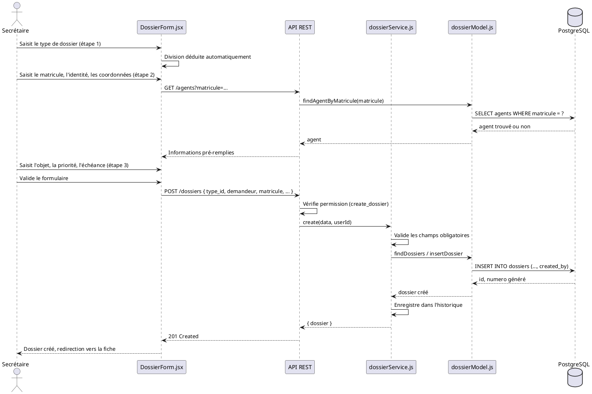
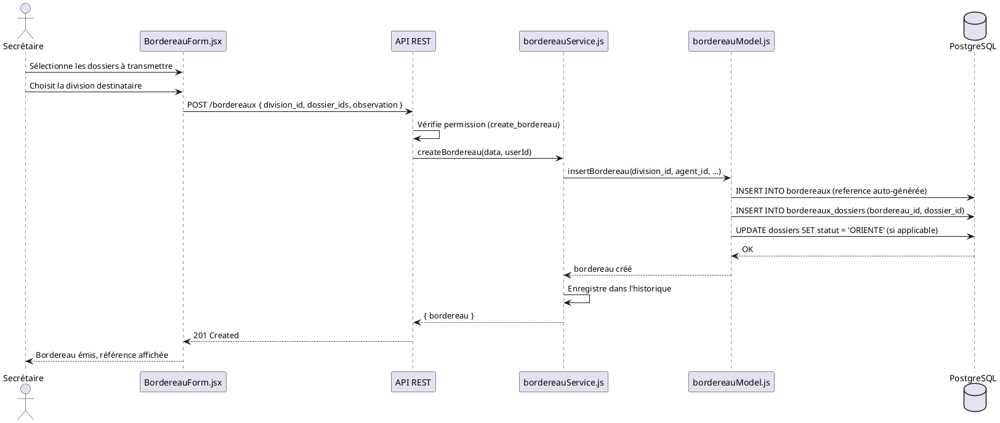
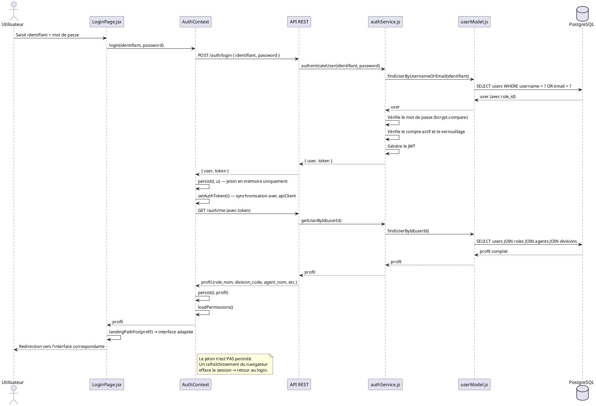
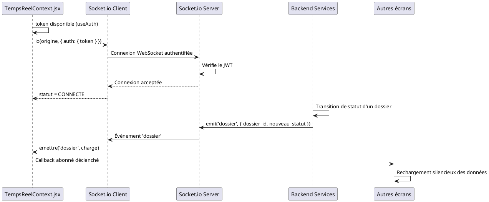
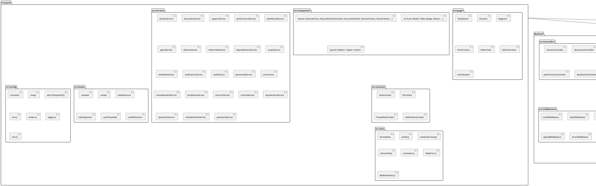
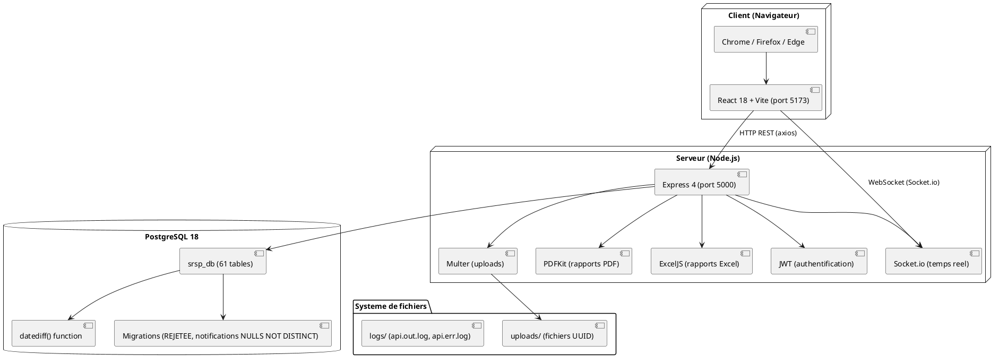

# CHAPITRE 6 : CONCEPTION DÉTAILLÉE

## 6.1 Architecture de l'application

### 6.1.1 Architecture générale

L'application SRSP Fitovinany adopte une **architecture trois tiers** (3-tier), composée de :

1. **Couche présentation** (Frontend) : application React 18 + Vite, servie sur le port 5173 en développement.
2. **Couche métier** (Backend) : API REST Node.js + Express, servie sur le port 5000.
3. **Couche données** (Base de données) : PostgreSQL 18, base `srsp_db`.

Cette architecture garantit la séparation des préoccupations (Separation of Concerns) : l'interface utilisateur ne contient aucune logique métier, le serveur ne contient aucune logique de présentation, et la base de données ne contient que des données et des contraintes d'intégrité.

### 6.1.2 Architecture frontend (React)

Le frontend est organisé en **couches** :

| Couche | Dossier | Rôle |
|---|---|---|
| **Pages** | `src/pages/` | Écrans complets (Dashboard, Dossiers, Rapports, Performance, Referentiel, etc.) |
| **Composants** | `src/components/` | Composants réutilisables (Card, Modal, Table, Badge, Button, etc.) |
| **Services** | `src/services/` | Appels API (dossierService, documentService, rapportService, etc.) |
| **Contextes** | `src/contexts/` | État global (AuthContext, UIContext, TempsReelContext, NotificationContext) |
| **Hooks** | `src/hooks/` | Logique réutilisable (useAuth, useApi, useDebounce, usePagination, etc.) |
| **Configuration** | `src/config/` | Constantes, triage, routes |
| **Utilitaires** | `src/utils/` | Fonctions utilitaires (formatDate, landing, notificationTarget, etc.) |

**Technologies frontend :**
- React 18.3 (composants fonctionnels, hooks)
- Vite 8.3 (bundler, HMR)
- React Router 6 (routage côté client)
- Tailwind CSS (styles utilitaires)
- Axios (client HTTP)
- Socket.io-client (temps réel)
- PDFKit / ExcelJS (génération de rapports côté serveur)

**Patterns utilisés :**
- **Context API** pour l'état global (authentification, thème, notifications, temps réel)
- **Custom hooks** pour la logique réutilisable (useAuth, useApi, useDebounce, usePagination, useTempsReel)
- **Composants contrôlés** pour les formulaires
- **Lazy loading** pour les routes (code splitting)

### 6.1.3 Architecture backend (Node.js/Express)

Le backend suit le pattern **MVC** (Model-View-Controller) adapté pour une API REST :

| Couche | Dossier | Rôle |
|---|---|---|
| **Routes** | `src/routes/` | Définition des endpoints REST et application des middlewares |
| **Middlewares** | `src/middlewares/` | Authentification (JWT), RBAC, scope dossiers, upload (multer), gestion d'erreurs |
| **Controllers** | `src/controllers/` | Orchestration : extraction des paramètres, appel des services, formatage des réponses |
| **Services** | `src/services/` | Logique métier : validation, calculs, orchestration des modèles |
| **Models** | `src/models/` | Accès aux données : requêtes SQL, transformations |
| **Config** | `src/config/` | Configuration (base de données, environnement, multer, logger, CORS) |
| **Utils** | `src/utils/` | Constantes, fonctions utilitaires, génération de numéros |

**Technologies backend :**
- Node.js 22+ (runtime JavaScript)
- Express 4 (framework HTTP)
- pg (node-postgres) — accès PostgreSQL
- JWT (jsonwebtoken) — authentification par jeton
- bcryptjs — hachage des mots de passe
- Multer — upload de fichiers
- Socket.io — temps réel
- PDFKit — génération de rapports PDF
- ExcelJS — génération de rapports Excel
- Joi — validation des données

**Patterns utilisés :**
- **Repository pattern** : les modèles encapsulent l'accès aux données
- **Service layer** : la logique métier est isolée des contrôleurs
- **Middleware chain** : authentification → RBAC → scope → contrôleur
- **Singleton** : pool de connexions PostgreSQL partagé

### 6.1.4 Architecture de la base de données

La base de données PostgreSQL 18 est organisée en **61 tables** réparties en 16 domaines fonctionnels :

| Domaine | Tables | Rôle |
|---|---|---|
| Référentiel | roles, permissions, role_permissions, users, priorites, statuts_dossiers, types_dossiers, sous_types_dossiers, divisions, antennes, districts, fonctions, types_courriers, types_documents, types_pieces, compteurs_numerotation, schemas_operations | Configuration et données de référence |
| Agents | agents, affectations, delegations, transferts, traitements | Gestion des agents et de leurs affectations |
| Dossiers | dossiers, dossiers_districts, dossier_commentaires, signalements_dossier, historique_actions, suppressions_dossiers | Entité centrale et son historique |
| Pièces & Documents | depouillements, documents, types_documents | Contrôle des pièces et pièces jointes versionnées |
| Workflow | verifications, validations | Vérification et validation |
| Courriers | courriers, types_courriers, correspondances | Gestion des courriers et correspondances |
| Bordereaux | bordereaux, bordereaux_dossiers | Transmissions entre divisions |
| Opérations | donnees_operation, schemas_operations, immatriculations, modes_paiement, insertions_paiement | Données d'opération par division |
| VISA | visas_controle_financier | Visa du contrôle financier |
| SOLDE | decomptes_avance, controles_decompte | Décomptes et contrôles de solde |
| PENSION | liquidations_pension, mandatements, mandatement_beneficiaires, mandatement_pieces, mandatement_pieces_etat, cachets_mandatement, signatures_ordonnateur, emargements, etats_emargement | Liquidation et mandatement de pension |
| SECOURS | references_logiciel_secours | Références du logiciel Secours |
| Archives | archives | Archivage des dossiers |
| Notifications | notifications, messages, reinitialisations_mot_de_passe | Notifications et messagerie |
| Compteurs | compteurs_numerotation | Numérotation automatique |

**Caractéristiques techniques :**
- Collation ICU `ci` (insensible à la casse)
- Timezone `Africa/Nairobi`
- Fonction `datediff(timestamp, timestamp)` pour la compatibilité MySQL→PostgreSQL
- Contrainte `NULLS NOT DISTINCT` sur les notifications (PG15+)
- 102 clés étrangères, 165 index

### 6.1.5 Sécurité

| Mécanisme | Implémentation |
|---|---|
| Authentification | JWT (8h d'expiration), bcrypt (coût 10) |
| Autorisation | RBAC : 13 rôles, permissions granulaires |
| Cloisonnement | Par division (chef de division) et par agent (agent technique) |
| Sessions | Révocation immédiate si compte désactivé ou mot de passe modifié |
| Upload | Multer, nom UUID, validation extension/taille, stockage privé |
| Téléchargement | Route authentifiée, résolution de chemin sous la racine uploads |
| SQL | Requêtes paramétrées (placeholders `?`), pas de concaténation |
| CORS | Origines configurées, credentials activés |
| Helmet | Headers de sécurité HTTP |

---

## 6.2 Diagramme de séquence de conception

### 6.2.1 Séquence — Réception et enregistrement d'un dossier

### 6.2.2 Séquence — Transmission d'un dossier (bordereau)

### 6.2.3 Séquence — Authentification et session

### 6.2.4 Séquence — Temps réel (WebSocket)

---

## 6.3 Diagramme de classe

Le diagramme de classes complet est disponible dans `docs/UML.puml` et `docs/UML.md` (section 1). Il représente les 61 entités du schéma PostgreSQL avec leurs attributs et les 102 relations (clés étrangères).

### 6.3.1 Classes principales (extrait)

```plantuml
@startuml SRSP_Classes_Principales
skinparam backgroundColor #FFFFFF

class User {
  +id : PK
  +username
  +email
  +role_id : FK
  +actif
  --
  +hasPermission(perm)
  +hasAnyPermission(perms)
  +isRole(...roles)
}

class Agent {
  +id : PK
  +user_id : FK
  +nom
  +prenom
  +matricule
  +fonction_id : FK
  +division_id : FK
  +actif
}

class Dossier {
  +id : PK
  +numero
  +type_id : FK
  +sous_type_id : FK
  +division_id : FK
  +priorite_id : FK
  +statut_id : FK
  +agent_responsable_id : FK
  +verificateur_id : FK
  +signataire_id : FK
  +origine_presentateur
  +comptable_presentateur
  +date_reception
  +date_cloture
  +date_archivage
  --
  +controlerCompletudeValidation()
  +valider()
  +signer()
  +archiver()
}

class TypeDossier {
  +id : PK
  +code
  +libelle
  +actif
}

class SousTypeDossier {
  +id : PK
  +type_dossier_id : FK
  +code
  +libelle
  +actif
  +ordre
}

class Division {
  +id : PK
  +code
  +nom
  +type_dossier_id : FK
  +responsable_id : FK
}

class StatutDossier {
  +id : PK
  +code
  +libelle
  +ordre
}

class Priorite {
  +id : PK
  +code
  +libelle
  +niveau
}

class TypePiece {
  +id : PK
  +code
  +libelle
  +type_dossier_id : FK
  +sous_type_id : FK
  +phase
  +obligatoire
  +actif
  +ordre
}

class Depouillement {
  +id : PK
  +dossier_id : FK
  +agent_id : FK
  +piece
  +presente
  +etat
  +motif
  +date_controle
  --
  +enregistrer()
  +getChecklist()
  +getResume()
}

class Document {
  +id : PK
  +dossier_id : FK
  +piece_code
  +version
  +remplace
  +nom_fichier
  +chemin_stockage
  +taille
  +upload_par : FK
  +created_at
  --
  +supprimer()
  +derniereVersion()
}

class HistoriqueAction {
  +id : PK
  +dossier_id : FK
  +user_id : FK
  +action
  +ancienne_valeur
  +nouvelle_valeur
  +details
  +date_action
}

class Bordereau {
  +id : PK
  +reference
  +division_id : FK
  +agent_id : FK
  +recu_par : FK
  +statut
  +date_transmission
}

class Courrier {
  +id : PK
  +numero
  +sens
  +type_id : FK
  +division_id : FK
  +dossier_id : FK
  +expediteur
  +destinataire
  +objet
  +created_by : FK
}

class Archive {
  +id : PK
  +dossier_id : FK
  +date_archivage
  +reference_archivage
  +emplacement_physique
  +localisation_numerique
  +archive_par : FK
  +restaure
}

class Notification {
  +id : PK
  +user_id : FK
  +dossier_id : FK
  +type
  +action
  +message
  +lu
  +created_at
}

class SignalementDossier {
  +id : PK
  +dossier_id : FK
  +division_id : FK
  +signale_par : FK
  +traite_par : FK
  +type
  +priorite
  +motif
  +statut
  +resolution
}

class DonneesOperation {
  +id : PK
  +dossier_id : FK
  +sous_type_id : FK
  +reference_externe
  +montant
  +source_montant
  +valide_par : FK
  +decision_controle
  +controleur_id : FK
}

class Mandatement {
  +id : PK
  +dossier_id : FK
  +numero
  +montant_total
  +etat
  +date_mandatement
}

class Role {
  +id : PK
  +nom
  +description
}

class Permission {
  +id : PK
  +nom
  +description
}

class ScopeService {
  +getScope(userId)
  +perimetrePour(scope)
  +filterFor(scope)
  +accesDossier(userId, dossierId)
}

' Relations
User "1" --> "0..1" Agent : compte
User "*" --> "1" Role : role
Role "1" --> "*" Permission : via role_permissions
Agent "0..1" --> "1" Division : division
Division "0..1" --> "1" TypeDossier : type par defaut

Dossier "1" --> "1" TypeDossier : type
Dossier "0..1" --> "1" SousTypeDossier : sous_type
Dossier "1" --> "1" Division : division
Dossier "1" --> "1" Priorite : priorite
Dossier "1" --> "1" StatutDossier : statut
Dossier "0..1" --> "1" Agent : responsable
Dossier "1" --> "1" User : cree_par
Dossier "0..1" --> "1" Agent : verificateur (VISA)
Dossier "0..1" --> "1" User : signataire

Dossier "1" --> "*" Depouillement : controle
Dossier "1" --> "*" Document : pieces jointes
Dossier "1" --> "*" HistoriqueAction : journal
Dossier "1" --> "*" Validation : validation
Dossier "1" --> "*" Verification : verification
Dossier "1" --> "*" SignalementDossier : signalement
Dossier "1" --> "*" DonneesOperation : operation
Dossier "1" --> "*" Mandatement : mandatement
Dossier "1" --> "*" Archive : archive
Dossier "1" --> "*" Notification : notification
Dossier "1" --> "*" Courrier : courrier
Dossier "1" --> "*" Correspondance : correspondance
Dossier "1" --> "*" BordereauDossier : transmission

TypePiece "0..1" --> "1" TypeDossier : type
TypePiece "0..1" --> "1" SousTypeDossier : sous_type
Depouillement "0..1" --> "1" Agent : controleur
Document "0..1" --> "1" User : deposite_par
Document "0..1" --> "1" TypeDocument : type
Document "0..1" --> "1" Courrier : piece liee

Validation "1" --> "1" User : valide_par
Verification "0..1" --> "1" Agent : verificateur
SignalementDossier "0..1" --> "1" Division : division
SignalementDossier "1" --> "1" User : signale_par
SignalementDossier "0..1" --> "1" User : traite_par

Bordereau "1" --> "1" Division : division
Bordereau "1" --> "1" Agent : emetteur
Bordereau "0..1" --> "1" Agent : recu_par
Bordereau "1" --> "*" BordereauDossier : ligne

Courrier "0..1" --> "1" Division : division
Courrier "0..1" --> "1" Dossier : dossier
Courrier "0..1" --> "1" Document : document
Courrier "1" --> "1" User : created_by

Mandatement "1" --> "1" Dossier : dossier
Mandatement "1" --> "*" MandatementBeneficiaire : beneficiaire
Mandatement "1" --> "*" MandatementPiece : piece
MandatementPiece "1" --> "*" MandatementPieceEtat : etat
Mandatement "1" --> "*" CachetMandatement : cachet
Mandatement "1" --> "*" SignatureOrdonnateur : signature
Mandatement "1" --> "*" Emargement : emargement
Mandatement "1" --> "*" EtatEmargement : etat
Mandatement "1" --> "*" ReferenceLogicielSecours : reference

Archive "1" --> "1" Dossier : dossier
Archive "1" --> "1" User : archive_par

Notification "1" --> "1" User : destinataire
Notification "0..1" --> "1" Dossier : dossier

DonneesOperation "1" --> "1" Dossier : dossier
DonneesOperation "0..1" --> "1" SousTypeDossier : sous_type
DonneesOperation "0..1" --> "1" User : valide_par
DonneesOperation "0..1" --> "1" User : controleur

VisaControleFinancier "1" --> "1" Dossier : dossier
VisaControleFinancier "1" --> "1" User : enregistre_par

DecompteAvance "1" --> "1" Dossier : dossier
DecompteAvance "0..1" --> "1" Agent : agent
ControleDecompte "1" --> "1" Dossier : dossier
ControleDecompte "0..1" --> "1" Agent : controleur

LiquidationPension "1" --> "1" Dossier : dossier
ReferenceLogicielSecours "1" --> "1" Mandatement : mandatement
ReferenceLogicielSecours "0..1" --> "1" User : reporte_par

Correspondance "1" --> "1" Dossier : dossier
Correspondance "1" --> "1" User : created_by

Immatriculation "1" --> "1" Dossier : dossier
Immatriculation "1" --> "1" Division : division
InsertionPaiement "1" --> "1" Dossier : dossier
InsertionPaiement "1" --> "1" ModePaiement : mode

Delegation "1" --> "1" Agent : agent
Delegation "1" --> "1" Agent : remplacant
Delegation "0..1" --> "1" User : created_by

Affectation "1" --> "1" Agent : agent
Affectation "1" --> "1" Division : division
Affectation "1" --> "1" Dossier : dossier

Transfert "1" --> "1" Dossier : dossier
Transfert "0..1" --> "1" Agent : ancien
Transfert "0..1" --> "1" Agent : nouveau

Traitement "1" --> "1" Dossier : dossier
Traitement "0..1" --> "1" Agent : agent

@enduml
```

## 6.4 Diagramme de paquetage

## 6.5 Diagramme de déploiement

---

*Fin du Chapitre 6 — Conception détaillée du projet SRSP Fitovinany*