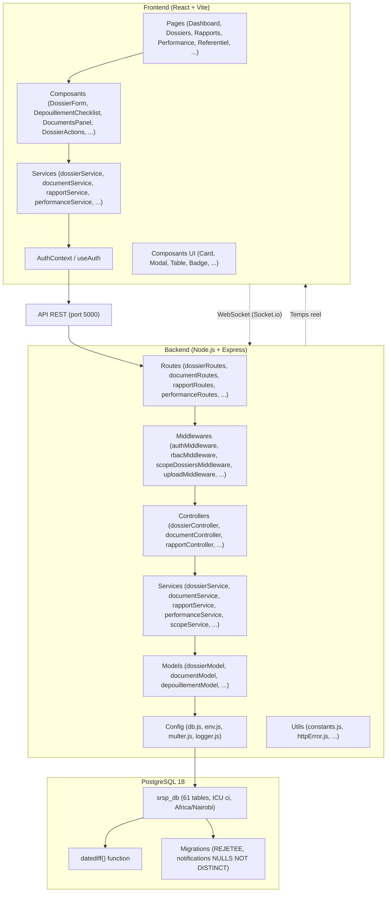
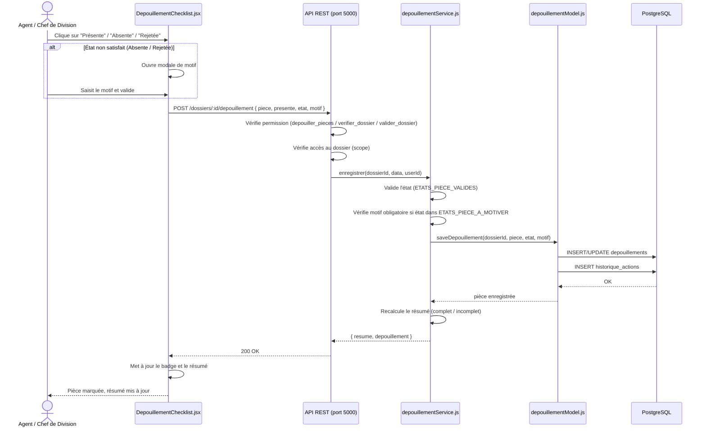
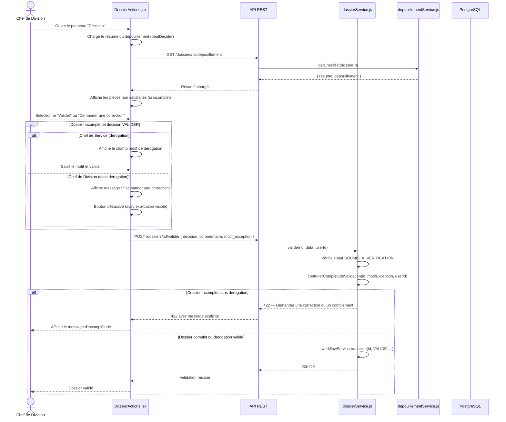
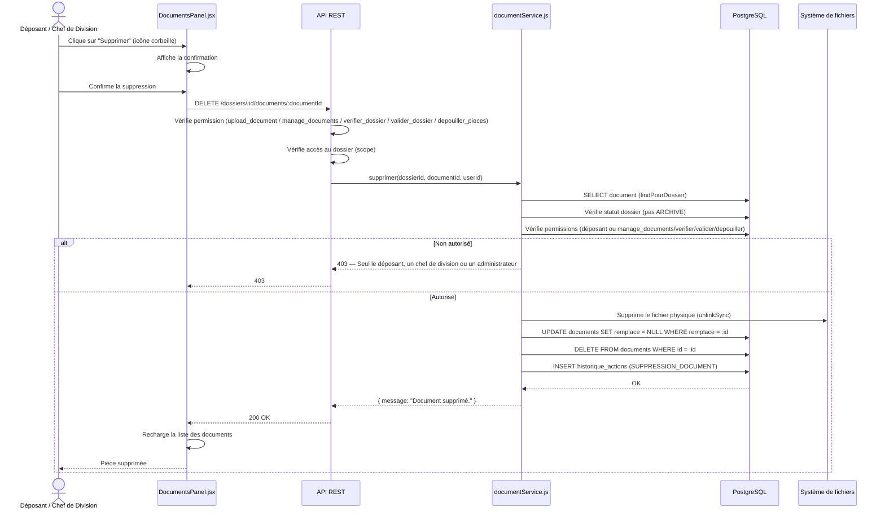
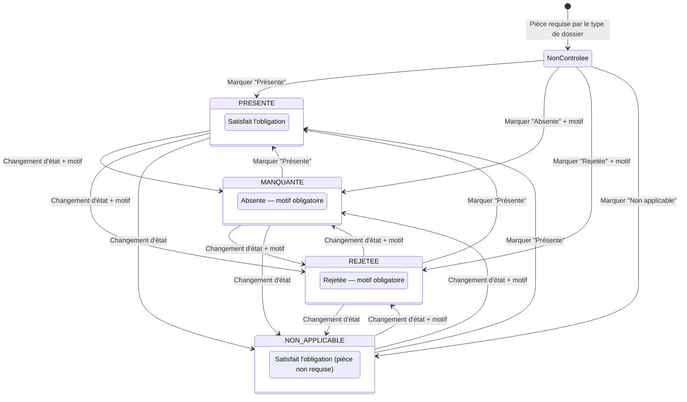
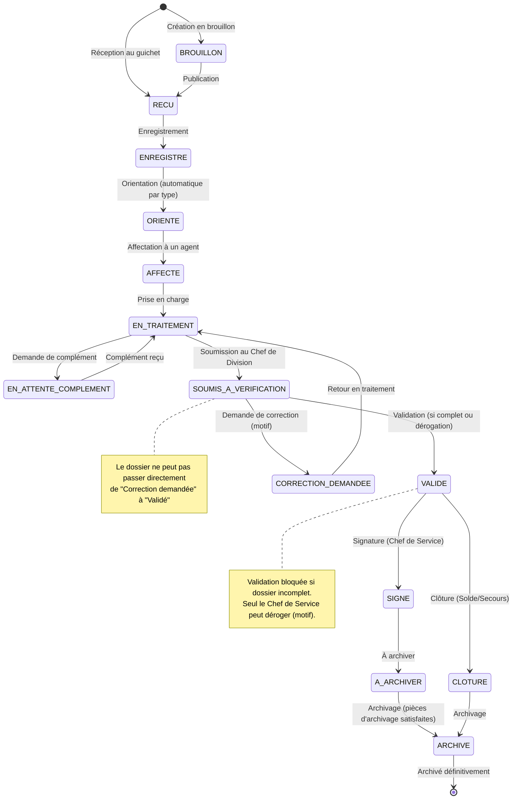
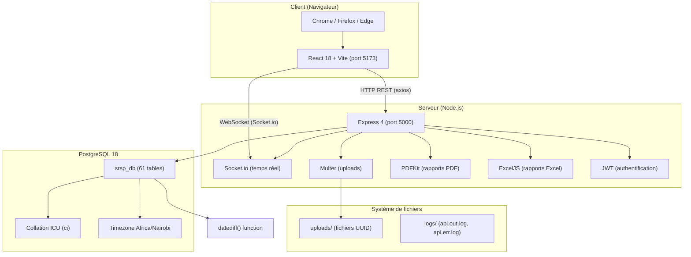

# UML — SRSP Fitovinany

Diagramme de classes (Mermaid) représentant l'ensemble des 61 entités du
schéma PostgreSQL `srsp_db` et leurs relations (clés étrangères). Chaque
entité porte ses attributs principaux ; les relations sont celles déclarées
dans `database/srsp_db.sql` (102 clés étrangères).

## Diagramme de classes

```mermaid
classDiagram
    %% =====================================================================
    %% REFERENTIEL
    %% =====================================================================
    namespace Referentiel {
        class roles {
            +id PK
            +nom
            +description
        }
        class permissions {
            +id PK
            +nom
            +description
        }
        class role_permissions {
            +role_id FK
            +permission_id FK
        }
        class users {
            +id PK
            +username
            +email
            +password_hash
            +role_id FK
            +actif
            +derniere_connexion
            +mot_de_passe_change_le
            +tentatives_echouees
            +verrouille_jusqua
        }
        class priorites {
            +id PK
            +code
            +libelle
            +niveau
        }
        class statuts_dossiers {
            +id PK
            +code
            +libelle
            +ordre
        }
        class types_dossiers {
            +id PK
            +code
            +libelle
            +actif
        }
        class sous_types_dossiers {
            +id PK
            +type_dossier_id FK
            +code
            +libelle
            +actif
            +ordre
        }
        class divisions {
            +id PK
            +code
            +nom
            +type_dossier_id FK
            +responsable_id FK
        }
        class antennes {
            +id PK
            +code
            +libelle
        }
        class districts {
            +id PK
            +code
            +libelle
            +antenne_id FK
        }
        class fonctions {
            +id PK
            +code
            +libelle
        }
        class types_courriers {
            +id PK
            +code
            +libelle
        }
        class types_documents {
            +id PK
            +code
            +libelle
        }
        class types_pieces {
            +id PK
            +code
            +libelle
            +type_dossier_id FK
            +sous_type_id FK
            +phase
            +obligatoire
            +actif
            +ordre
        }
        class compteurs_numerotation {
            +cle PK
            +valeur
        }
        class schemas_operations {
            +id PK
            +sous_type_id FK
            +code
            +libelle
        }
    }

    %% =====================================================================
    %% AGENTS & AFFECTATIONS
    %% =====================================================================
    namespace Agents {
        class agents {
            +id PK
            +user_id FK
            +nom
            +prenom
            +matricule
            +fonction_id FK
            +division_id FK
            +email
            +telephone
            +actif
        }
        class affectations {
            +id PK
            +agent_id FK
            +division_id FK
            +dossier_id FK
            +date_affectation
        }
        class delegations {
            +id PK
            +agent_id FK
            +remplacant_id FK
            +created_by FK
            +date_debut
            +date_fin
            +motif
        }
        class transferts {
            +id PK
            +dossier_id FK
            +ancien_agent_id FK
            +nouveau_agent_id FK
            +date_transfert
            +motif
        }
        class traitements {
            +id PK
            +dossier_id FK
            +agent_id FK
            +date_traitement
            +observation
        }
    }

    %% =====================================================================
    %% DOSSIERS
    %% =====================================================================
    namespace Dossiers {
        class dossiers {
            +id PK
            +numero
            +reference_visa
            +type_id FK
            +sous_type_id FK
            +objet
            +demandeur
            +matricule
            +date_reception
            +date_heure_reception
            +date_limite
            +division_id FK
            +priorite_id FK
            +statut_id FK
            +agent_responsable_id FK
            +observation
            +date_cloture
            +date_archivage
            +created_by FK
            +demandeur_nom
            +demandeur_prenom
            +demandeur_tel
            +demandeur_email
            +demandeur_adresse
            +origine_presentateur
            +comptable_presentateur
            +type_acte
            +annee_reference
            +verificateur_id FK
            +date_signature
            +signataire_id FK
            +reference_signature
            +exception_validation
            +exception_autorisee_par FK
            +date_exception
            +motif_complement
            +beneficiaire
            +organisme
        }
        class dossiers_districts {
            +id PK
            +dossier_id FK
            +district_id FK
        }
        class dossier_commentaires {
            +id PK
            +dossier_id FK
            +auteur_id FK
            +contenu
            +date_commentaire
        }
        class signalements_dossier {
            +id PK
            +dossier_id FK
            +division_id FK
            +signale_par FK
            +traite_par FK
            +type
            +priorite
            +motif
            +statut
            +date_signalement
            +date_traitement
            +resolution
        }
        class historique_actions {
            +id PK
            +dossier_id FK
            +user_id FK
            +action
            +ancienne_valeur
            +nouvelle_valeur
            +details
            +ip_address
            +date_action
        }
        class suppressions_dossiers {
            +id PK
            +dossier_id
            +numero
            +motif
            +supprime_par FK
            +supprime_par_nom
            +date_suppression
            +historique_json
            +nb_actions_historique
        }
    }

    %% =====================================================================
    %% PIECES & DOCUMENTS
    %% =====================================================================
    namespace PiecesDocuments {
        class depouillements {
            +id PK
            +dossier_id FK
            +agent_id FK
            +piece
            +presente
            +etat
            +observation
            +motif
            +date_controle
        }
        class documents {
            +id PK
            +dossier_id FK
            +courrier_id FK
            +type_id FK
            +piece_code
            +version
            +remplace
            +motif_remplacement
            +nom_fichier
            +chemin_stockage
            +taille
            +description
            +valide
            +upload_par FK
            +created_at
        }
        class types_documents {
            +id PK
            +code
            +libelle
        }
    }

    %% =====================================================================
    %% WORKFLOW / VERIFICATION / VALIDATION
    %% =====================================================================
    namespace Workflow {
        class verifications {
            +id PK
            +dossier_id FK
            +agent_id FK
            +resultat
            +observation
            +date_verification
        }
        class validations {
            +id PK
            +dossier_id FK
            +valide_par FK
            +decision
            +commentaire
            +date_validation
        }
    }

    %% =====================================================================
    %% COURRIERS & CORRESPONDANCES
    %% =====================================================================
    namespace Courriers {
        class courriers {
            +id PK
            +numero
            +sens
            +type_id FK
            +division_id FK
            +dossier_id FK
            +document_id FK
            +expediteur
            +destinataire
            +objet
            +created_by FK
            +created_at
        }
        class types_courriers {
            +id PK
            +code
            +libelle
        }
        class correspondances {
            +id PK
            +dossier_id FK
            +type
            +reference
            +piece_code
            +etat_reponse
            +date_envoi
            +date_reponse
            +created_by FK
        }
    }

    %% =====================================================================
    %% BORDEREAUX & TRANSMISSIONS
    %% =====================================================================
    namespace Bordereaux {
        class bordereaux {
            +id PK
            +reference
            +division_id FK
            +agent_id FK
            +recu_par FK
            +statut
            +date_transmission
            +observation
        }
        class bordereaux_dossiers {
            +bordereau_id FK
            +dossier_id FK
        }
    }

    %% =====================================================================
    %% OPERATIONS PAR DIVISION
    %% =====================================================================
    namespace Operations {
        class donnees_operation {
            +id PK
            +dossier_id FK
            +sous_type_id FK
            +reference_externe
            +reference_dossier_mere
            +periode
            +montant
            +source_montant
            +valide_par FK
            +date_validation
            +decision_controle
            +date_controle
            +controleur_id FK
            +destinataire
            +localisation
            +observation
        }
        class schemas_operations {
            +id PK
            +sous_type_id FK
            +code
            +libelle
        }
        class immatriculations {
            +id PK
            +dossier_id FK
            +type_demande
            +reference
            +division_id FK
            +created_at
        }
        class modes_paiement {
            +id PK
            +code
            +libelle
        }
        class insertions_paiement {
            +id PK
            +dossier_id FK
            +mode_paiement_id FK
            +reference
            +date_insertion
        }
    }

    %% =====================================================================
    %% VISA
    %% =====================================================================
    namespace Visa {
        class visas_controle_financier {
            +id PK
            +dossier_id FK
            +numero_visa
            +date_visa
            +enregistre_par FK
        }
    }

    %% =====================================================================
    %% SOLDE
    %% =====================================================================
    namespace Solde {
        class decomptes_avance {
            +id PK
            +dossier_id FK
            +agent_id FK
            +montant
            +date_decompte
        }
        class controles_decompte {
            +id PK
            +dossier_id FK
            +controleur_id FK
            +decision
            +date_controle
        }
    }

    %% =====================================================================
    %% PENSION
    %% =====================================================================
    namespace Pension {
        class liquidations_pension {
            +id PK
            +dossier_id FK
            +montant
            +date_liquidation
        }
        class mandatements {
            +id PK
            +dossier_id FK
            +numero
            +montant_total
            +etat
            +date_mandatement
        }
        class mandatement_beneficiaires {
            +id PK
            +mandatement_id FK
            +nom
            +prenom
            +montant
        }
        class mandatement_pieces {
            +id PK
            +mandatement_id FK
            +code
            +libelle
        }
        class mandatement_pieces_etat {
            +id PK
            +mandatement_piece_id FK
            +etat
            +date_controle
        }
        class cachets_mandatement {
            +id PK
            +mandatement_id FK
            +cache_par FK
            +date_cache
        }
        class signatures_ordonnateur {
            +id PK
            +mandatement_id FK
            +signe_par FK
            +date_signature
            +reference_signature
        }
        class emargements {
            +id PK
            +mandatement_id FK
            +beneficiaire_id FK
            +date_emargement
        }
        class etats_emargement {
            +id PK
            +mandatement_id FK
            +genere_par FK
            +date_generation
        }
    }

    %% =====================================================================
    %% SECOURS
    %% =====================================================================
    namespace Secours {
        class references_logiciel_secours {
            +id PK
            +mandatement_id FK
            +code
            +libelle
            +valeur
            +reporte_par FK
            +reporte_le
        }
    }

    %% =====================================================================
    %% ARCHIVES
    %% =====================================================================
    namespace Archives {
        class archives {
            +id PK
            +dossier_id FK
            +date_archivage
            +reference_archivage
            +emplacement_physique
            +localisation_numerique
            +archive_par FK
            +restaure
        }
    }

    %% =====================================================================
    %% NOTIFICATIONS & MESSAGES
    %% =====================================================================
    namespace Notifications {
        class notifications {
            +id PK
            +user_id FK
            +dossier_id FK
            +type
            +action
            +message
            +lu
            +created_at
        }
        class messages {
            +id PK
            +expediteur_id FK
            +destinataire_id FK
            +contenu
            +date_envoi
            +lu
        }
        class reinitialisations_mot_de_passe {
            +id PK
            +user_id FK
            +code
            +date_demande
            +date_expiration
            +utilise
        }
    }

    %% =====================================================================
    %% RELATIONS (cles etrangeres)
    %% =====================================================================
    roles "1" --> "*" role_permissions : contient
    permissions "1" --> "*" role_permissions : accorde
    users "1" --> "*" role_permissions : possede
    users "1" --> "0..1" agents : compte
    roles "1" --> "*" users : role
    agents "1" --> "0..1" divisions : responsable
    agents "1" --> "0..1" fonctions : fonction

    types_dossiers "1" --> "*" sous_types_dossiers : contient
    types_dossiers "1" --> "*" divisions : type par defaut
    divisions "1" --> "*" dossiers : accueille
    priorites "1" --> "*" dossiers : priorite
    statuts_dossiers "1" --> "*" dossiers : statut
    agents "1" --> "*" dossiers : responsable
    users "1" --> "*" dossiers : cree_par
    sous_types_dossiers "1" --> "*" dossiers : sous_type
    dossiers "1" --> "*" dossiers_districts : rattachement
    districts "1" --> "*" dossiers_districts : district
    antennes "1" --> "*" districts : antenne

    dossiers "1" --> "*" depouillements : controle
    agents "1" --> "*" depouillements : controleur
    dossiers "1" --> "*" documents : pieces jointes
    users "1" --> "*" documents : deposite_par
    types_documents "1" --> "*" documents : type
    courriers "1" --> "0..1" documents : piece liee
    types_pieces "1" --> "*" depouillements : code piece

    dossiers "1" --> "*" verifications : verification
    agents "1" --> "*" verifications : verificateur
    dossiers "1" --> "*" validations : validation
    users "1" --> "*" validations : valide_par
    dossiers "1" --> "*" traitements : traitement
    agents "1" --> "*" traitements : agent
    dossiers "1" --> "*" historique_actions : journal
    users "1" --> "*" historique_actions : auteur
    dossiers "1" --> "*" dossier_commentaires : commentaire
    users "1" --> "*" dossier_commentaires : auteur
    dossiers "1" --> "*" signalements_dossier : signalement
    users "1" --> "*" signalements_dossier : signale_par / traite_par
    divisions "1" --> "*" signalements_dossier : division
    users "1" --> "*" suppressions_dossiers : supprime_par

    dossiers "1" --> "*" affectations : affectation
    agents "1" --> "*" affectations : agent
    divisions "1" --> "*" affectations : division
    agents "1" --> "*" delegations : agent / remplacant
    users "1" --> "*" delegations : created_by
    dossiers "1" --> "*" transferts : transfert
    agents "1" --> "*" transferts : ancien / nouveau

    dossiers "1" --> "*" courriers : courrier
    divisions "1" --> "*" courriers : division
    types_courriers "1" --> "*" courriers : type
    users "1" --> "*" courriers : created_by
    dossiers "1" --> "*" correspondances : correspondance
    users "1" --> "*" correspondances : created_by

    divisions "1" --> "*" bordereaux : bordereau
    agents "1" --> "*" bordereaux : emetteur / recu_par
    bordereaux "1" --> "*" bordereaux_dossiers : ligne
    dossiers "1" --> "*" bordereaux_dossiers : dossier

    dossiers "1" --> "*" donnees_operation : operation
    sous_types_dossiers "1" --> "*" donnees_operation : sous_type
    users "1" --> "*" donnees_operation : valide_par / controleur_id
    schemas_operations "1" --> "*" sous_types_dossiers : schema
    dossiers "1" --> "*" immatriculations : immatriculation
    divisions "1" --> "*" immatriculations : division
    dossiers "1" --> "*" insertions_paiement : insertion
    modes_paiement "1" --> "*" insertions_paiement : mode

    dossiers "1" --> "*" visas_controle_financier : visa
    users "1" --> "*" visas_controle_financier : enregistre_par

    dossiers "1" --> "*" decomptes_avance : decompte
    agents "1" --> "*" decomptes_avance : agent
    dossiers "1" --> "*" controles_decompte : controle
    agents "1" --> "*" controles_decompte : controleur

    dossiers "1" --> "*" liquidations_pension : liquidation
    dossiers "1" --> "*" mandatements : mandatement
    mandatements "1" --> "*" mandatement_beneficiaires : beneficiaire
    mandatements "1" --> "*" mandatement_pieces : piece
    mandatement_pieces "1" --> "*" mandatement_pieces_etat : etat
    mandatements "1" --> "*" cachets_mandatement : cachet
    users "1" --> "*" cachets_mandatement : cache_par
    mandatements "1" --> "*" signatures_ordonnateur : signature
    users "1" --> "*" signatures_ordonnateur : signe_par
    mandatements "1" --> "*" emargements : emargement
    mandatement_beneficiaires "1" --> "*" emargements : beneficiaire
    mandatements "1" --> "*" etats_emargement : etat
    users "1" --> "*" etats_emargement : genere_par
    mandatements "1" --> "*" references_logiciel_secours : reference
    users "1" --> "*" references_logiciel_secours : reporte_par

    dossiers "1" --> "*" archives : archive
    users "1" --> "*" archives : archive_par

    users "1" --> "*" notifications : notification
    dossiers "1" --> "*" notifications : notification
    users "1" --> "*" messages : expediteur / destinataire
    users "1" --> "*" reinitialisations_mot_de_passe : reinitialisation

    users "1" --> "*" roles : role (via role_permissions)
    users "1" --> "*" permissions : permission (via role_permissions)
```

## Diagramme d'architecture (composants)



## Diagramme de séquence — Marquage d'une pièce (Présente/Absente/Rejetée)



## Diagramme de séquence — Décision du Chef de Division (Valider / Correction)



## Diagramme de séquence — Suppression d'une pièce jointe



## Diagramme d'états — Cycle de vie d'une pièce au dépouillement



## Diagramme d'états — Cycle de vie d'un dossier



## Diagramme de déploiement

